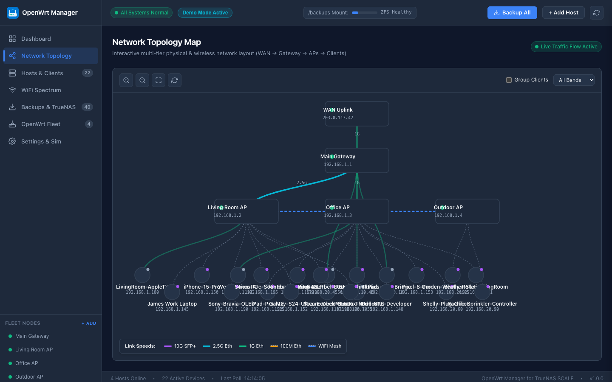
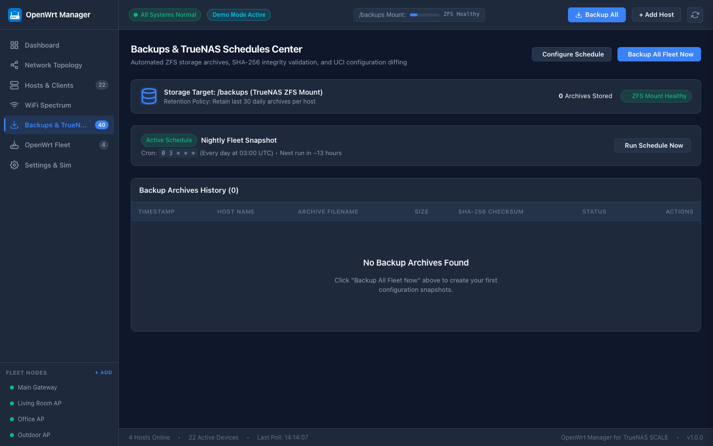

# OpenWrt Manager (`openwrt-managor`)

[](docs/DEPLOYMENT.md)
[](https://nodejs.org/)
[](https://openwrt.org/)
[](docs/ARCHITECTURE.md)
[](docs/API_REFERENCE.md#3-testing--quality-assurance)
[](LICENSE)

**OpenWrt Manager** is a lightweight, self-hosted web management console built for **TrueNAS SCALE** (or any Docker/Linux host) to monitor, analyze, update, and back up fleets of OpenWrt routers, wireless access points (APs), and mesh nodes.

It includes a built-in **Live Multi-Host Telemetry Simulator** for immediate evaluation out of the box, while seamlessly connecting to physical OpenWrt hardware via SSH and HTTP `ubus` JSON-RPC.

---

## Main Features

### 1. Multi-Host Fleet Monitoring & Interactive Topology
- **Unified Fleet Dashboard:** Real-time router health, CPU/RAM load bars, dual-line WAN/LAN throughput sparklines, and active system alerts across all OpenWrt gateways and APs.
- **Interactive Network Topology Graph:** Multi-tier SVG graph (`WAN` &rarr; `Gateway` &rarr; `Secondary APs & Mesh` &rarr; `Clients`) with negotiated link speeds (`10G` / `2.5G` / `1G` / `Mesh`) and a slide-out node inspector.
- **Consolidated Client Inventory:** Merges gateway DHCP leases, ARP/reverse-DNS tables, and multi-AP `iwinfo` station lists with automatic roaming de-duplication and hardware manufacturer identification.

### 2. Wi-Fi RF Spectrum Analysis & 3D Location Triangulation
- **Tri-Band Airtime & Congestion Analyzer (`2.4 / 5 / 6 GHz`):** Polls `iw survey dump` across all managed radios to measure channel busy/active utilization (`%`), visualize `20/40/80/160 MHz` spectral envelopes, highlight overlapping frequency zones, and recommend the cleanest channel per band.
- **Active Neighbor Scanning & Vendor Lookup:** Runs fleet-wide `iw scan` passes, compares per-radio RSSI side-by-side, and resolves hardware manufacturers via IEEE OUI, virtual BSSID bit-unmasking, and SSID heuristics.
- **3D Foreign AP RF Triangulation (`Lat / Long / Altitude`):** Uses wireless OpenWrt APs as geodetic anchors (`Latitude`, `Longitude`, and `Altitude`) to project East-North-Up (ENU) meter coordinates, compensate for multi-floor 3D slant ranges, and triangulate neighboring AP locations on an expandable **Large / Full Screen** spatial radar map with interactive zoom and pan.  
  &rarr; *[Read the Wi-Fi Spectrum & 3D Triangulation Guide](docs/WIFI_SPECTRUM_AND_TRIANGULATION.md)*

### 3. Background Package Updates & Attended Sysupgrade Firmware Manager
- **Package & Firmware Advisories:** Tracks pending `opkg` / `apk` package upgrades and detects available OpenWrt firmware releases via **Attended Sysupgrade** (`auc` / `owut` / LuCI ASU).
- **Non-Blocking Background Upgrades:** Runs package and firmware upgrades in background SSH streams with a global real-time progress banner and live console output modal.

### 4. Automated TrueNAS Backups & Side-by-Side UCI Diff Viewer
- **Scheduled & On-Demand Backups:** Cron/interval `sysupgrade -b` `.tar.gz` backups with SHA-256 verification and automatic retention pruning on TrueNAS ZFS datasets.
- **In-Memory UCI Config Diffing:** Inspect `.tar.gz` archives and compare `/etc/config/*` files (`network`, `wireless`, `firewall`, `dhcp`, `system`) side-by-side in memory without temporary disk extraction.

### 5. Hermes & External AI Agent REST API
- **Agent-Ready Endpoints (`/api/agent/*` & `/api/openapi.json`):** Built-in OpenAPI 3.1.0 specification, tool manifest, and single-call fleet status summaries so agents like **Hermes** can query OpenWrt host health, Wi-Fi congestion, and pending updates.  
  &rarr; *[Read the REST API & Hermes Agent Reference](docs/API_REFERENCE.md)*

---

## Documentation Hub

| Guide | Description |
| :--- | :--- |
| **[Deployment & OpenWrt Setup Guide](docs/DEPLOYMENT.md)** | Local quick start, TrueNAS SCALE Docker Compose, ZFS dataset setup, environment variables, and OpenWrt router preparation. |
| **[Wi-Fi Spectrum & 3D Location Triangulation](docs/WIFI_SPECTRUM_AND_TRIANGULATION.md)** | `iw survey dump` congestion analysis, `iw scan` vendor resolution, `Lat / Long / Altitude` geodetic calibration, and 3D slant-range trilateration math. |
| **[REST API & Hermes Agent Reference](docs/API_REFERENCE.md)** | Complete HTTP endpoint catalog, Hermes AI agent integration (`/api/agent/*`, `/api/openapi.json`), API key auth, and test suite overview. |
| **[System Architecture Specification](docs/ARCHITECTURE.md)** | Deep-dive technical blueprint, subsystem diagrams, data contracts, atomic flat-file storage protocols, and engine algorithms. |
| **[UX & Accessibility Specification](docs/UX_SPEC.md)** | User journeys, visual design system, interactive component states, keyboard navigation, and WCAG 2.2 AA accessibility compliance. |

---

## Quick Start

```bash
git clone https://github.com/jameslloyd/openwrt-managor.git
cd openwrt-managor
npm install
npm start
```

Open **`http://localhost:8080`** in your browser. The app launches immediately in **Demo Mode** with a live 4-node simulated OpenWrt fleet until you add physical OpenWrt hosts.

For **TrueNAS SCALE Docker Compose** and physical OpenWrt router setup, see **[docs/DEPLOYMENT.md](docs/DEPLOYMENT.md)**.

---

## Screenshots

| Overview Dashboard | Interactive Network Topology |
| :---: | :---: |
|  |  |

| Tri-Band Wi-Fi Spectrum Analyzer | Clients Inventory & TrueNAS Backups Diff |
| :---: | :---: |
|  |  |

---

## License

This project is licensed under the [MIT License](LICENSE).
