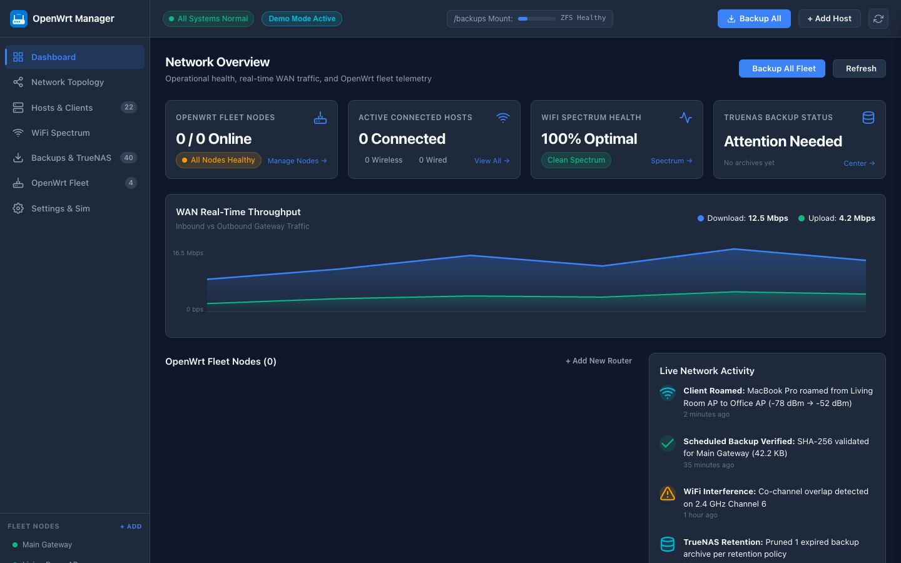
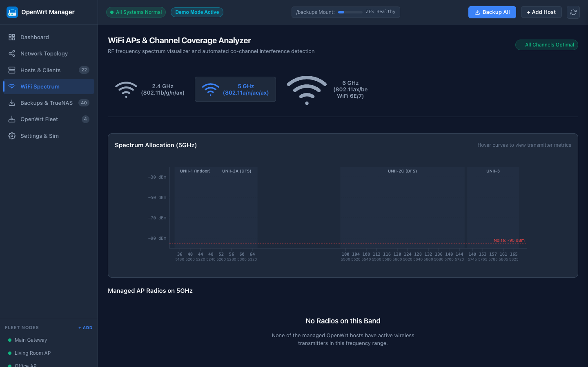
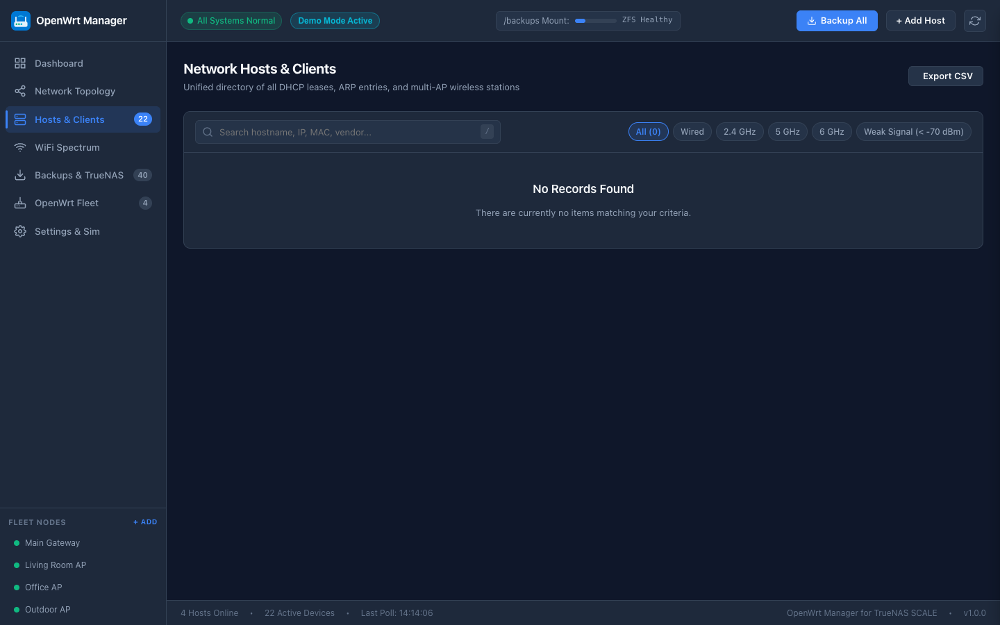
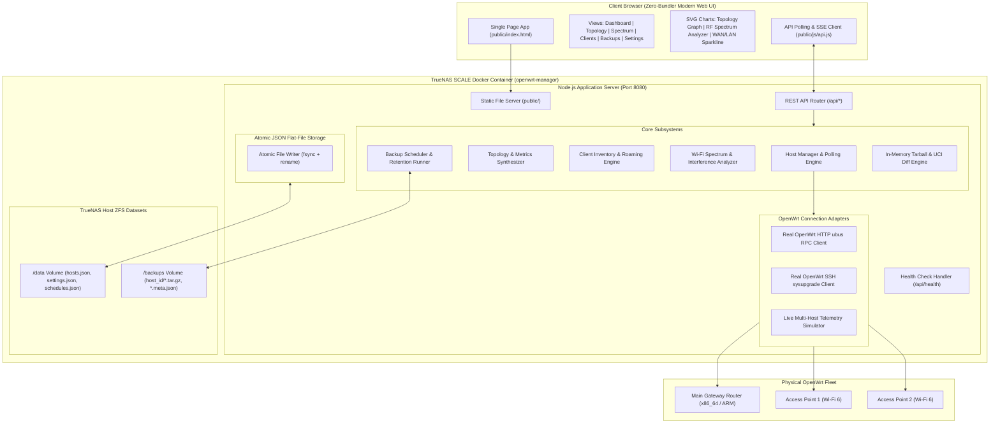
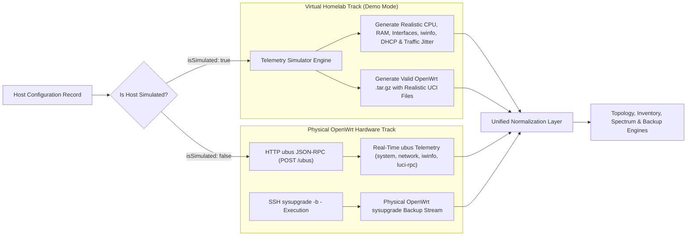
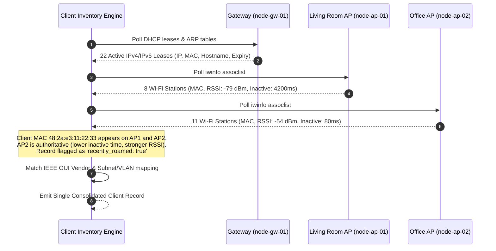
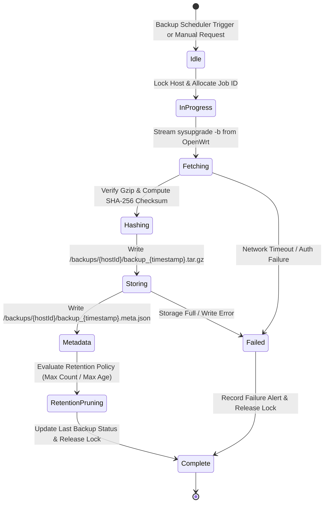

# OpenWrt Manager (`openwrt-managor`)

[](https://www.truenas.com/)
[](https://nodejs.org/)
[](https://openwrt.org/)
[](#system-architecture--design)
[](#testing--quality-assurance)
[](LICENSE)

**OpenWrt Manager** is a high-performance, lightweight, self-hosted web management console engineered specifically to run in Docker on **TrueNAS SCALE** (or any Docker/Linux host). It unifies the monitoring, visualization, and automated configuration backups for fleets of OpenWrt routers, access points (APs), and wireless mesh extenders.

Out of the box, it features a built-in **Live Multi-Host Telemetry Simulator** generating realistic homelab network traffic, multi-band Wi-Fi channels, and client roaming behavior—allowing immediate evaluation without hardware, while providing seamless connectivity to physical OpenWrt hardware via HTTP `ubus` RPC and SSH `sysupgrade -b`.

---

## Table of Contents
- [Screenshots Gallery](#screenshots-gallery)
- [Key Features](#key-features)
- [System Architecture & Design](#system-architecture--design)
  - [High-Level Architecture](#high-level-architecture)
  - [Hybrid Real Hardware & Simulator Pipeline](#hybrid-real-hardware--simulator-pipeline)
  - [Multi-AP Client De-Duplication & Roaming Resolution](#multi-ap-client-de-duplication--roaming-resolution)
  - [Automated Backup, Retention & UCI Diff Pipeline](#automated-backup-retention--uci-diff-pipeline)
- [TrueNAS SCALE Docker Deployment Guide](#truenas-scale-docker-deployment-guide)
  - [Docker Compose Configuration](#docker-compose-configuration)
  - [ZFS Dataset Recommendations](#zfs-dataset-recommendations)
  - [Environment Variables](#environment-variables)
- [Quick Start Guide](#quick-start-guide)
  - [Running Locally](#running-locally)
  - [Connecting Physical OpenWrt Routers](#connecting-physical-openwrt-routers)
- [REST API Reference Summary](#rest-api-reference-summary)
- [Testing & Quality Assurance](#testing--quality-assurance)
- [Documentation Links](#documentation-links)
- [License](#license)

---

## Screenshots Gallery

### 1. Overview Dashboard
Real-time fleet health, KPI metric summary cards, live dual-line WAN/LAN SVG throughput sparkline, router hardware utilization bars (CPU/RAM), and event activity stream.


---

### 2. Interactive Network Topology Map
Hierarchical multi-tier network graph (Tier 0 WAN &rarr; Tier 1 Main Gateway &rarr; Tier 2 Secondary APs & Mesh Backhaul &rarr; Tier 3 Wired and Wireless Clients) with color-coded negotiated link speeds (10G/2.5G/1G/100M/Mesh), animated active packet traffic, and slide-out node inspector drawer.


---

### 3. Tri-Band Wi-Fi RF Spectrum & Channel Coverage Analyzer
Visual RF spectrum analyzer covering 2.4 GHz, 5 GHz (UNII-1, UNII-2/DFS, UNII-3), and 6 GHz (UNII-5 through UNII-8). Displays mathematical 20/40/80/160 MHz parabolic signal curves, channel centers, ambient noise floors, and automated co-channel / adjacent-channel interference warning overlays.


---

### 4. Network Hosts & Clients Inventory
Consolidated client table aggregating DHCP leases, ARP entries, and multi-AP `iwinfo` association lists. Features instant search, multi-facet filtering (Host, Band, VLAN, Weak Signal), 5-bar RSSI/SNR signal gauges, real-time throughput metrics, and client roaming history.


---

### 5. TrueNAS Backups & Side-by-Side UCI Config Diff Viewer
Automated cron/interval backup engine with persistent TrueNAS ZFS storage tracking, one-click manual backups, SHA-256 integrity verification, in-memory `.tar.gz` archive inspection, and high-contrast side-by-side UCI configuration diff modal (`network`, `wireless`, `firewall`, `dhcp`, `system`).


---

## Key Features

- **TrueNAS SCALE Native:** Designed from the ground up for TrueNAS SCALE Docker deployment with decoupled `/data` (application configuration) and `/backups` (OpenWrt `.tar.gz` configuration archives) volumes, unprivileged execution (`node` user UID/GID 1000), and automated health checks.
- **Hybrid Real & Simulated Operation:** Works instantly out of the box with a rich 4-node simulated homelab fleet (Dual-2.5G Gateway, Wi-Fi 6 Living Room AP, Wi-Fi 6 Office AP, Wi-Fi 5 Mesh AP, and 22 active client devices), while fully supporting physical OpenWrt devices via HTTP `ubus` JSON-RPC and SSH.
- **Zero-Bundler Modern Web Frontend:** Pure native ES Modules (ESM) with zero Webpack/Vite build steps, native CSS Custom Properties, semantic HTML5 `<dialog>` modals, and responsive layout for desktop, tablet, and mobile browsers.
- **Multi-AP Client De-Duplication:** Resolves roaming clients across multiple access points by correlating Wi-Fi association inactive times, signal strengths, DHCP leases, and IEEE OUI vendor hardware lookups.
- **Tri-Band Wi-Fi Spectrum Visualizer:** Generates mathematical spectral bandwidth masks (20, 40, 80, 160 MHz) and alerts network administrators to co-channel contention and adjacent-channel degradation.
- **Automated Configuration Backup & Inspection Engine:** Scheduled cron/interval backups per router, SHA-256 checksum tracking, automated retention policy pruning, zero-temporary-file in-memory `.tar.gz` UCI configuration extraction, and side-by-side colorized diffing.
- **Atomic Flat-File Storage Engine:** Zero external database dependencies; app configuration and schedules are written atomically using a write-to-temp, `fsync`, and atomic rename pattern (`0o600` permissions) preventing corruption during sudden NAS power loss.

---

## System Architecture & Design

### High-Level Architecture



---

### Hybrid Real Hardware & Simulator Pipeline



---

### Multi-AP Client De-Duplication & Roaming Resolution



---

### Automated Backup, Retention & UCI Diff Pipeline



For complete technical specifications, see:
- [docs/ARCHITECTURE.md](docs/ARCHITECTURE.md) &mdash; Complete System Architecture, Data Contracts, Storage Protocols & REST API Catalog
- [docs/UX_SPEC.md](docs/UX_SPEC.md) &mdash; Detailed UX Specification, User Journeys, WCAG 2.2 AA Accessibility & Interaction States

---

## TrueNAS SCALE Docker Deployment Guide

### Docker Compose Configuration

Create a custom application in TrueNAS SCALE (or run via standard Docker Compose):

```yaml
version: "3.8"

services:
  openwrt-managor:
    image: openwrt-managor:latest
    build:
      context: .
      dockerfile: Dockerfile
    container_name: openwrt-managor
    restart: unless-stopped
    ports:
      - "8080:8080"
    environment:
      - NODE_ENV=production
      - PORT=8080
      - DATA_DIR=/data
      - BACKUP_DIR=/backups
      - DEMO_MODE=true
      - POLL_INTERVAL_MS=10000
      - LOG_LEVEL=info
    volumes:
      # TrueNAS ZFS Datasets for persistent app state and backups
      - /mnt/pool/appdata/openwrt-managor/data:/data
      - /mnt/pool/backups/openwrt:/backups
    healthcheck:
      test: ["CMD", "node", "-e", "require('http').get('http://localhost:8080/api/health', (r) => {process.exit(r.statusCode === 200 ? 0 : 1)}).on('error', () => process.exit(1))"]
      interval: 30s
      timeout: 5s
      retries: 3
      start_period: 10s
    labels:
      net.truenas.scale.description: "OpenWrt Multi-Host Fleet Manager and Backup Center"
```

### ZFS Dataset Recommendations

On TrueNAS SCALE, create two dedicated ZFS datasets:
1. `/mnt/pool/appdata/openwrt-managor/data`:
   - Stores `hosts.json`, `settings.json`, and `schedules.json`.
   - Permissions: UID `1000`, GID `1000` (Node.js runtime user).
2. `/mnt/pool/backups/openwrt`:
   - Stores gzip `.tar.gz` configuration archives and `.meta.json` sidecar files.
   - Recommended ZFS dataset options: `compression=zstd` (or `lz4`), regular ZFS snapshots.

### Environment Variables

| Variable | Type | Default | Description |
| :--- | :--- | :--- | :--- |
| `PORT` | Integer | `8080` | Internal HTTP listening port |
| `DATA_DIR` | String | `/data` | Path to persistent database directory |
| `BACKUP_DIR` | String | `/backups` | Path to persistent configuration backup storage |
| `DEMO_MODE` | Boolean | `true` | When true, activates live multi-host simulator when no hosts exist |
| `POLL_INTERVAL_MS`| Integer | `10000` | Background host telemetry polling interval (ms) |
| `BACKUP_TIMEOUT_MS`| Integer | `30000` | Timeout for router backup operations (ms) |
| `LOG_LEVEL` | String | `info` | Logging verbosity (`debug`, `info`, `warn`, `error`) |

---

## Quick Start Guide

### Running Locally

```bash
# 1. Clone the repository
git clone https://github.com/jameslloyd/openwrt-managor.git
cd openwrt-managor

# 2. Install dependencies
npm install

# 3. Start the application
npm start

# 4. Open in browser
# Navigate to http://localhost:8080
```

The application starts immediately in **Demo Mode**, displaying the 4-node simulated homelab network with live traffic, Wi-Fi channel spectrums, and clients.

### Connecting Physical OpenWrt Routers

1. Ensure the router has `rpcd-mod-luci` or `uhttpd-mod-ubus` enabled:
   ```bash
   opkg update
   opkg install rpcd-mod-luci uhttpd-mod-ubus
   /etc/init.d/rpcd restart
   /etc/init.d/uhttpd restart
   ```
2. In OpenWrt Manager, click **"Add OpenWrt Host"**.
3. Enter the router IP, HTTP port (default `80`), username (`root`), and password.
4. Click **"Test Connection"** to verify real-time connectivity, detected model, and firmware version.
5. Save the host to start automated polling and backups.

---

## REST API Reference Summary

| Method | Endpoint | Description |
| :--- | :--- | :--- |
| `GET` | `/api/health` | Container healthcheck (status, uptime, storage checks) |
| `GET` | `/api/system/info` | Host system info, Node runtime, memory usage |
| `GET` | `/api/settings` | Global settings (poll interval, retention rules, alerts) |
| `PUT` | `/api/settings` | Update global settings |
| `GET` | `/api/hosts` | List all managed OpenWrt routers and APs |
| `POST` | `/api/hosts` | Register a new OpenWrt host |
| `GET` | `/api/hosts/:id` | Get single host configuration and telemetry |
| `PUT` | `/api/hosts/:id` | Update host configuration |
| `DELETE`| `/api/hosts/:id` | Delete host from fleet |
| `POST` | `/api/hosts/test` | Test credentials and connectivity for unsaved host |
| `POST` | `/api/hosts/:id/test` | Test credentials and connectivity for registered host |
| `GET` | `/api/topology` | Synthesized network topology graph (`nodes` & `links`) |
| `GET` | `/api/clients` | Searchable, filterable network client inventory |
| `GET` | `/api/clients/:mac` | Client detail view with roaming and signal history |
| `GET` | `/api/wifi/channels` | Tri-band (2.4/5/6 GHz) spectrum dataset & radios |
| `GET` | `/api/wifi/interference`| Co-channel and adjacent-channel interference warnings |
| `GET` | `/api/backups` | List all stored OpenWrt backup archives and metadata |
| `POST` | `/api/backups/run` | Execute on-demand configuration backup (`hostId: "all"`) |
| `GET` | `/api/backups/:id/download` | Stream `.tar.gz` archive download |
| `GET` | `/api/backups/:id/files` | In-memory listing of archive files |
| `GET` | `/api/backups/:id/file-content` | Stream textual content of a specific UCI file |
| `GET` | `/api/backups/:id/diff/:otherId` | Unified line-by-line diff between two backups |
| `DELETE`| `/api/backups/:id` | Delete a backup archive and sidecar metadata |
| `GET` | `/api/backups/schedules` | View automated cron backup schedules |
| `PUT` | `/api/backups/schedules` | Update automated cron backup schedules |
| `POST` | `/api/backups/schedules/:id/run` | Immediately execute a backup schedule |
| `GET` | `/api/simulator/status` | Simulator status and active mock topology state |
| `POST` | `/api/simulator/configure` | Adjust simulation parameters (roaming, traffic spike) |
| `POST` | `/api/simulator/reset` | Reseed default homelab fleet |

---

## Testing & Quality Assurance

The test suite runs using Node.js's native test runner (`node:test` and `node:assert`) with **zero external test dependencies**:

```bash
npm test
```

### Test Suite Highlights (21 Passing Tests):
- **Health & System Info:** Validates 200 responses, memory metrics, and volume availability.
- **Host Management & Probes:** Validates CRUD operations, credential masking, and live async connection testing.
- **Topology Synthesis:** Verifies multi-tier node hierarchies, edge capacities, throughput aggregation, and VLAN mapping.
- **Client De-Duplication & Roaming:** Verifies de-duplication across multi-AP association lists, RSSI arbitration, and OUI lookups.
- **Wi-Fi RF Spectrum & Overlap:** Verifies 2.4 GHz, 5 GHz, and 6 GHz spectrum models and co-channel interference detection.
- **Tarball Inspection & UCI Diff:** Verifies in-memory gzip tarball unpacking, file manifests, and colorized unified line diff generation.
- **Retention Pruning Engine:** Verifies max backup counts, age limits, and minimum retention guarantees.
- **Atomic Storage Engine:** Verifies collision-free atomic writes with `fsync` and `0o600` file mode permissions.

---

## Documentation Links

- [Architecture Specification (`docs/ARCHITECTURE.md`)](docs/ARCHITECTURE.md) &mdash; Complete technical blueprint, JSON schemas, protocol specifications, and container architecture.
- [UX Specification (`docs/UX_SPEC.md`)](docs/UX_SPEC.md) &mdash; Interaction states, user journeys, accessibility (WCAG 2.2 AA), and keyboard shortcuts.

---

## License

This project is licensed under the [MIT License](LICENSE).
