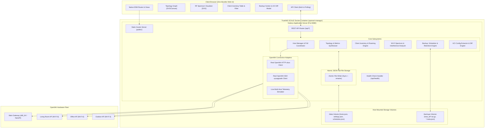
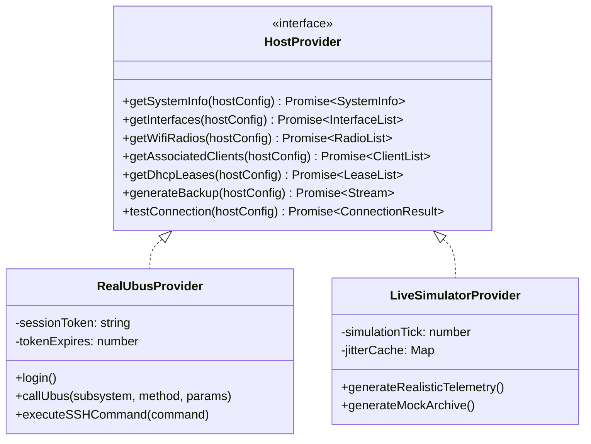
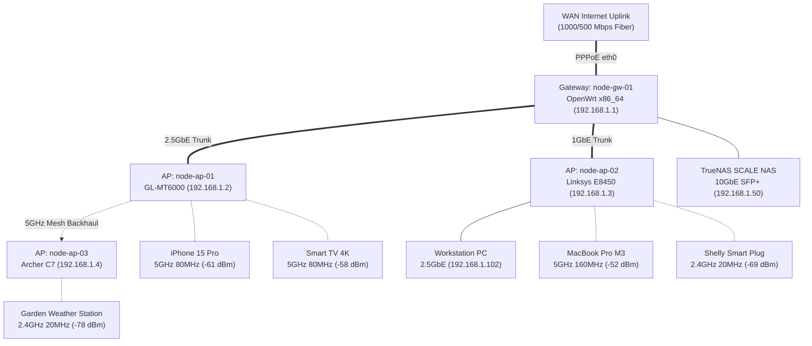
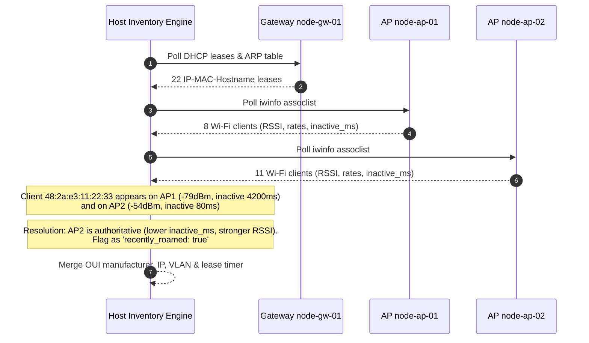
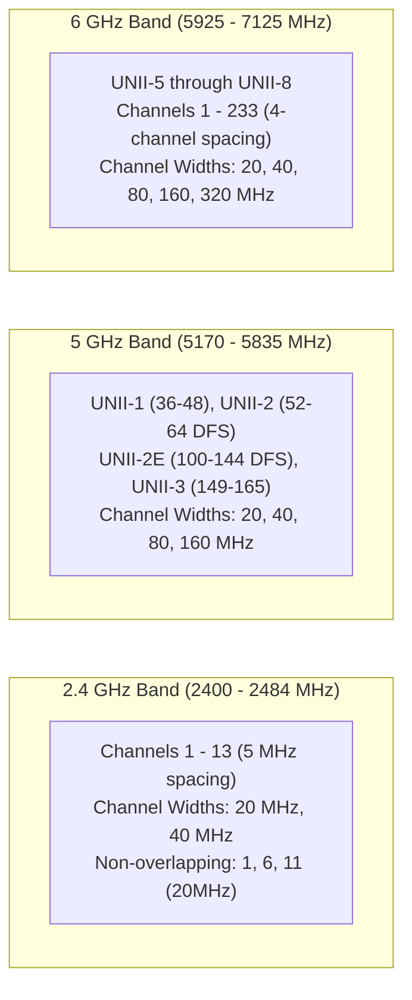
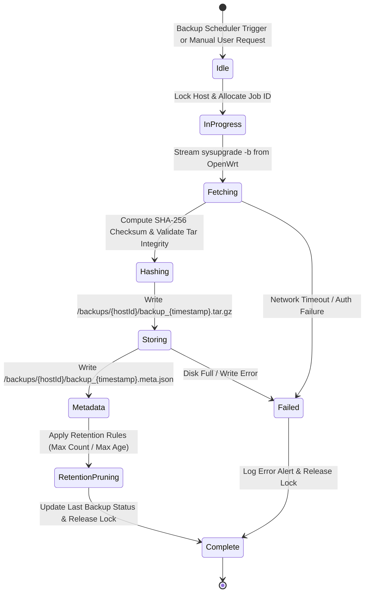
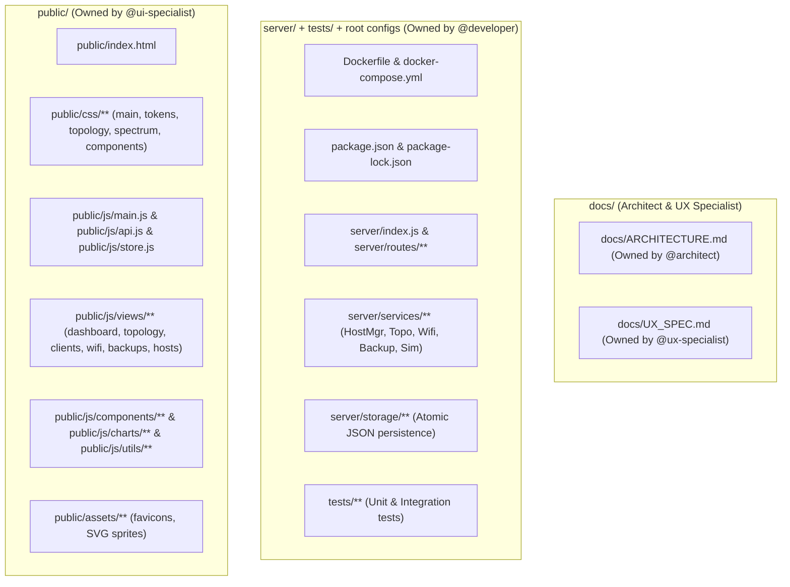

# OpenWrt Manager ("openwrt-managor")
## System Architecture & Technical Specification

> **Status:** Approved Architecture Baseline  
> **Target Environment:** TrueNAS SCALE (Docker / Docker Compose), Self-Hosted Homelab, Multi-Host OpenWrt Networks  
> **Runtime Stack:** Node.js 20+ (Lightweight ESM Backend) & Native Zero-Bundler ESM Modern Web Frontend  
> **Primary Stakeholders:** `@coordinator`, `@architect`, `@developer`, `@ui-specialist`, `@ux-specialist`

---

## 1. Executive Summary & System Vision

**OpenWrt Manager** (`openwrt-managor`) is a high-performance, lightweight, self-hosted web management console engineered specifically to run in Docker on TrueNAS SCALE. It solves the operational challenge of managing multiple OpenWrt routers, access points (APs), and mesh extenders across home and small-office networks.

### Core Value Pillars
1. **TrueNAS SCALE First-Class Docker Deployment:** Simple, rock-solid container deployment using Docker Compose with decoupled persistent volumes (`/data` for configuration & state; `/backups` for OpenWrt configuration archives).
2. **Hybrid Real & Simulated Operation:** Works seamlessly out of the box using an integrated **Live Multi-Host Telemetry Simulator** generating realistic network traffic, Wi-Fi channel environments, and client behavior, while supporting real OpenWrt hardware via HTTP `ubus` RPC and SSH `sysupgrade -b`.
3. **Interactive Network Topology:** Real-time visual network hierarchy (WAN &rarr; Main Gateway &rarr; Secondary APs / Mesh Nodes &rarr; Wired & Wireless Clients) with active link throughput, VLAN tags, and port health.
4. **Unified Client Host Inventory:** Centralized searchable and filterable database of all network clients, correlating DHCP leases, ARP entries, and multi-AP Wi-Fi association tables (`iwinfo`) with live signal statistics (RSSI, SNR, PHY rates).
5. **Multi-Band Wi-Fi Spectrum Analyzer:** Visual RF spectrum model spanning 2.4 GHz, 5 GHz, and 6 GHz bands with channel widths (20/40/80/160 MHz), signal curves, noise floors, and automatic co-channel/adjacent-channel interference detection.
6. **Automated Configuration Backup & Inspection Engine:** Scheduled cron/interval backups, SHA-256 integrity verification, automated retention pruning, in-memory `.tar.gz` UCI configuration inspection (`/etc/config/*`), side-by-side diffing, and one-click restoration downloads.
7. **Zero-Bundler Modern Web Frontend:** 100% native ES Modules (ESM) with zero Webpack/Vite build steps, native CSS variables, responsive mobile-first UI, and strict separation between backend (`server/`) and frontend (`public/`).

---

## 2. System Architecture & Component Model

The system is designed with a clean decoupled architecture where the backend runs an asynchronous Node.js engine and serves the frontend as static modern ES modules.



---

## 3. TrueNAS SCALE & Docker Deployment Architecture

### 3.1 Container Runtime Specification
- **Base Image:** `node:20-alpine` (minimal attack surface, ~180MB, fast pull).
- **Process Model:** Non-root execution (`node` user, UID 1000 / GID 1000) with permissions configurable via environment variables (`PUID`/`PGID`).
- **Internal Ports:** `8080` (HTTP web interface and API).
- **Persistent Mounts:**
  - `/data`: Read/Write volume storing JSON configuration files and app state.
  - `/backups`: Read/Write volume storing `.tar.gz` OpenWrt configuration archives and metadata sidecar files.
- **Process Supervisor:** Direct Node.js execution with clean `SIGTERM`/`SIGINT` graceful shutdown handling.

### 3.2 Environment Variables Configuration

| Variable | Type | Default | Description |
| :--- | :--- | :--- | :--- |
| `PORT` | Integer | `8080` | Web server listening port inside container |
| `DATA_DIR` | String | `/data` | Path to persistent database directory |
| `BACKUP_DIR` | String | `/backups` | Path to persistent configuration backup storage |
| `DEMO_MODE` | Boolean | `true` | If true, seeds and activates the multi-host simulator when no hosts exist |
| `POLL_INTERVAL_MS`| Integer | `10000` | Background host telemetry polling interval (milliseconds) |
| `BACKUP_TIMEOUT_MS`| Integer| `30000` | Timeout for router backup operations (milliseconds) |
| `LOG_LEVEL` | String | `info` | Logging verbosity (`debug`, `info`, `warn`, `error`) |

### 3.3 TrueNAS SCALE `docker-compose.yml` Specification

```yaml
version: "3.8"

services:
  openwrt-managor:
    image: openwrt-managor:latest
    build:
      context: .
      dockerfile: Dockerfile
    container_name: openwrt-managor
    restart: unless-stopped
    ports:
      - "8080:8080"
    environment:
      - NODE_ENV=production
      - PORT=8080
      - DATA_DIR=/data
      - BACKUP_DIR=/backups
      - DEMO_MODE=true
      - POLL_INTERVAL_MS=10000
      - LOG_LEVEL=info
    volumes:
      - /mnt/pool/appdata/openwrt-managor/data:/data
      - /mnt/pool/backups/openwrt:/backups
    healthcheck:
      test: ["CMD", "node", "-e", "require('http').get('http://localhost:8080/api/health', (r) => {process.exit(r.statusCode === 200 ? 0 : 1)}).on('error', () => process.exit(1))"]
      interval: 30s
      timeout: 5s
      retries: 3
      start_period: 10s
    labels:
      net.truenas.scale.description: "OpenWrt Multi-Host Fleet Manager and Backup Center"
```

### 3.4 Dockerfile Specification
```dockerfile
FROM node:20-alpine AS runner

WORKDIR /app

# Install openssh-client and tar/gzip utilities for real router communications
RUN apk add --no-cache openssh-client tar gzip tzdata

# Set production environment
ENV NODE_ENV=production
ENV DATA_DIR=/data
ENV BACKUP_DIR=/backups
ENV PORT=8080

# Create required directories
RUN mkdir -p /data /backups /app

# Copy dependency specifications and install production dependencies
COPY package*.json ./
RUN npm ci --only=production

# Copy application backend and frontend assets
COPY server/ ./server/
COPY public/ ./public/

# Ensure appropriate permissions for persistent directories
RUN chown -R node:node /app /data /backups

# Switch to unprivileged node user
USER node

EXPOSE 8080

HEALTHCHECK --interval=30s --timeout=5s --start-period=10s --retries=3 \
  CMD node -e "require('http').get('http://localhost:' + (process.env.PORT || 8080) + '/api/health', (r) => {process.exit(r.statusCode === 200 ? 0 : 1)}).on('error', () => process.exit(1))"

CMD ["node", "server/index.js"]
```

---

## 4. OpenWrt Communication & Live Telemetry Simulator Architecture

### 4.1 Hybrid Host Connection Interface
The backend implements a uniform `HostProvider` abstraction pattern so that the UI, metrics aggregator, and backup engines never care whether a host is physical hardware or a simulated virtual node.



### 4.2 Real OpenWrt HTTP `ubus` Protocol Details
1. **Authentication Handshake (`auth.login`):**
   - Endpoint: `POST http(s)://<ROUTER_IP>/ubus`
   - Payload:
     ```json
     {
       "jsonrpc": "2.0",
       "id": 1,
       "method": "call",
       "params": [
         "00000000000000000000000000000000",
         "session",
         "login",
         { "username": "root", "password": "<PASSWORD>" }
       ]
     }
     ```
   - Success Response returns a 32-character session token string: `ubus_rpc_session`.
2. **Telemetry RPC Methods:**
   - `system info`: CPU load (1m/5m/15m), total & free RAM, uptime, kernel version.
   - `network.device status`: Ethernet port status (link up/down, negotiated speed 100/1000/2500 Mbps, RX/TX byte counters, error counters).
   - `network.interface dump`: Subnet IPs, netmasks, gateways, DNS servers, PPPoE WAN status, VLAN interface bindings.
   - `iwinfo info` (per wireless interface): SSID, BSSID, radio band, operating frequency, channel, width, transmit power, noise floor.
   - `iwinfo assoclist` (per wireless interface): Connected station MAC addresses, signal (dBm), noise (dBm), inactive time, RX/TX negotiated PHY rate (e.g., HE-MCS 11, 1201 Mbps).
   - `luci-rpc getDHCPLeases`: Active IPv4 and IPv6 DHCP leases (IP, MAC, hostname, lease expiration timestamp).
3. **Real Backup Retrieval:**
   - Primary: SSH execution of `/sbin/sysupgrade -b -` streaming tarball bytes via stdout.
   - Alternative: LuCI HTTP RPC `sysupgrade` endpoint with basic/session authentication.

### 4.3 Built-in Live Multi-Host Telemetry Simulator
The simulator provides an out-of-the-box homelab environment with 4 realistic OpenWrt routers/APs and 22 client devices:

#### Default Simulated Nodes Fleet:
1. **`node-gw-01` (Main Gateway):**
   - Model: *OpenWrt x86_64 Dual 2.5GbE Appliance* (Intel N100, 4-core, 8GB RAM).
   - Role: Gateway & Firewall. WAN PPPoE (1000/500 Mbps fiber), LAN (`br-lan` 192.168.1.1/24), Guest VLAN 10 (192.168.10.1/24), IoT VLAN 20 (192.168.20.1/24).
   - Interfaces: `eth0` (WAN 2.5G), `eth1` (Trunk to APs 2.5G).
2. **`node-ap-01` (Living Room AP):**
   - Model: *GL.iNet GL-MT6000 (Flint 2)* (MediaTek MT7986, Wi-Fi 6).
   - Radios:
     - Radio 0 (2.4 GHz): Channel 6, Width 20 MHz, TX 23 dBm, SSID `Homelab-IoT` + `Homelab-Main`.
     - Radio 1 (5 GHz): Channel 36, Width 80 MHz, TX 26 dBm, SSID `Homelab-Main`.
   - Wired Trunk: 2.5 Gbps Ethernet backhaul to Gateway.
3. **`node-ap-02` (Office AP):**
   - Model: *Linksys E8450 (Belkin RT3200)* (MediaTek MT7622B, Wi-Fi 6).
   - Radios:
     - Radio 0 (2.4 GHz): Channel 1, Width 20 MHz, TX 20 dBm, SSID `Homelab-Main`.
     - Radio 1 (5 GHz): Channel 149, Width 160 MHz, TX 28 dBm, SSID `Homelab-Main` + `Homelab-Guest`.
   - Wired Trunk: 1 Gbps Ethernet backhaul.
4. **`node-ap-03` (Outdoor / Garden AP):**
   - Model: *TP-Link Archer C7 v5* (Qualcomm Atheros QCA9563, Wi-Fi 5 AC1750).
   - Radios:
     - Radio 0 (2.4 GHz): Channel 11, Width 20 MHz, TX 24 dBm, SSID `Homelab-Main`.
     - Radio 1 (5 GHz): Channel 100 (DFS), Width 80 MHz, TX 23 dBm, SSID `Homelab-Main`.
   - Backhaul: Wireless Mesh backhaul to Living Room AP (5 GHz 802.11s).

#### Dynamic Simulation Realism Engine:
- **Bandwidth Fluctuation:** Per-tick randomized Gaussian jitter for active client traffic (e.g. 4K streaming TV pulls 15-28 Mbps; idling smart plugs pull 2-12 Kbps).
- **Client Roaming:** Configurable probability that a mobile phone or laptop transitions from `node-ap-01` to `node-ap-02` with brief RSSI drops and handover event logging.
- **Realistic OpenWrt Tarball Generation:** Generates valid `.tar.gz` gzip archives on-the-fly containing realistic `/etc/config/network`, `/etc/config/wireless`, `/etc/config/firewall`, `/etc/config/dhcp`, and `/etc/config/system` files matching each simulated router's hardware identity.

---

## 5. Network Topology Engine Specification

The Topology Engine computes an unified hierarchical graph representation of the entire infrastructure.



### 5.1 Topology Node & Link Schema
The topology graph is serialized as a standardized `{ nodes: Node[], links: Link[] }` payload:
- **`Node` Properties:**
  - `id`: Unique string (e.g., `"gw-01"`, `"ap-01"`, `"client-a4:83:e7:..."`).
  - `label`: Human-readable name.
  - `type`: Enum `["wan", "gateway", "ap", "switch", "client_wired", "client_wifi_2g", "client_wifi_5g", "client_wifi_6g"]`.
  - `ip`: Primary IPv4 address.
  - `mac`: Primary hardware MAC address.
  - `status`: `"online" | "degraded" | "offline"`.
  - `hostId`: Foreign key to parent OpenWrt host (for APs and gateways).
  - `metrics`: `{ cpuUsagePct, memUsagePct, rxRateBps, txRateBps, clientCount }`.
- **`Link` Properties:**
  - `id`: Link identifier (e.g., `"link-gw-ap1"`).
  - `source`: Node ID.
  - `target`: Node ID.
  - `medium`: `"ethernet" | "wifi_mesh" | "wifi_station"`.
  - `speedMbps`: Link capacity (e.g., `2500`, `1000`, `1201`).
  - `currentRxBps`: Real-time active RX bandwidth.
  - `currentTxBps`: Real-time active TX bandwidth.
  - `signalDbm`: RSSI in dBm (for Wi-Fi links; null for Ethernet).
  - `vlans`: Array of VLAN IDs carried (e.g., `[1, 10, 20]`).

---

## 6. Network Hosts Inventory & Client De-Duplication Engine

### 6.1 Multi-AP De-Duplication Pipeline
In a multi-AP network, a client MAC address can appear simultaneously in ARP tables, DHCP lease tables, and multiple AP association lists (during fast BSS transitions or stale timeouts). The De-Duplication Engine synthesizes a single authoritative client record:



### 6.2 Host Record Data Contract
Each consolidated client record contains:
- `mac`: Normalized lowercase MAC address (e.g., `"48:2a:e3:11:22:33"`).
- `ip`: Active IPv4 address.
- `ipv6`: Active IPv6 address (if present).
- `hostname`: Hostname from DHCP option 12 or manual override name.
- `vendor`: OUI Manufacturer name (e.g., `"Apple, Inc."`, `"Intel Corporate"`).
- `connectedTo`: `{ hostId: "node-ap-02", hostName: "Living Room AP", iface: "wlan1" }`.
- `connectionType`: `"wired"` | `"wifi_2g"` | `"wifi_5g"` | `"wifi_6g"`.
- `ssid`: Wi-Fi SSID (or `null` if wired).
- `channel`: Operating RF channel number.
- `signalDbm`: Received signal strength (e.g., `-55`).
- `noiseDbm`: Ambient noise level (e.g., `-95`).
- `snrDb`: Signal-to-Noise Ratio (calculated: `signalDbm - noiseDbm`).
- `rxRateMbps`: Current negotiated PHY receive rate.
- `txRateMbps`: Current negotiated PHY transmit rate.
- `rxBytesTotal`: Cumulative received bytes.
- `txBytesTotal`: Cumulative transmitted bytes.
- `rxRateBps`: Current instant throughput bytes/sec.
- `txRateBps`: Current instant throughput bytes/sec.
- `dhcpLeaseRemainingSec`: Remaining seconds until DHCP lease renewal.
- `isGuest`: Boolean indicating if assigned to Guest VLAN/subnet.
- `lastSeen`: ISO 8601 timestamp.

---

## 7. Wi-Fi Spectrum & Channel Coverage Analyzer Specification

### 7.1 Multi-Band Frequency & Channel Models
The RF Spectrum Analyzer maps physical channel frequencies, bandwidth envelopes, and co-channel interference across three primary frequency bands:



### 7.2 Frequency & Center Channel Formulas
For standard IEEE 802.11 bands:
- **2.4 GHz:** $f_c = 2412 + 5 \times (ch - 1)\text{ MHz}$ (for channels 1–13); Channel 14 = 2484 MHz.
- **5 GHz:** $f_c = 5000 + 5 \times ch\text{ MHz}$ (e.g., Channel 36 = 5180 MHz; Channel 149 = 5745 MHz).
- **6 GHz:** $f_c = 5950 + 5 \times ch\text{ MHz}$ (e.g., Channel 1 = 5955 MHz).

### 7.3 Mathematical Curve Model for SVG Spectrum Rendering
Each active AP radio generates an RF spectral envelope curve rendered in the frontend as an SVG `<path>` element.
- **Bandwidth Span:** $[f_{\text{start}}, f_{\text{end}}] = [f_c - \frac{BW}{2}, f_c + \frac{BW}{2}]$
- **Curve Shape:** A smoothed trapezoid with flat-top passband and rolloff skirts:
  - Flat top passband width: $BW_{\text{flat}} = 0.85 \times BW$
  - Skirt rolloff span: $\Delta f_{\text{skirt}} = 0.075 \times BW$ on each side
  - Peak amplitude: Corresponds to measured AP TX Power or Signal level in dBm (e.g., $-30\text{ dBm}$ to $-80\text{ dBm}$)
  - Baseline: Ambient noise floor (e.g., $-95\text{ dBm}$)

### 7.4 Interference Detection Algorithm
The Wi-Fi engine analyzes all active radios across the OpenWrt fleet and detects interference:
1. **Co-Channel Interference (CCI):** Two or more APs sharing the exact same primary channel (or overlapping center frequencies within the channel width).
   - *Severity: High* if both APs have $> 5$ active clients or active channel utilization $> 40\%$.
2. **Adjacent-Channel Interference (ACI):** Partially overlapping channels where channel edges collide (e.g., in 2.4 GHz, AP A on Channel 1 and AP B on Channel 3).
   - *Severity: Critical* because non-orthogonal OFDM subcarriers cause unrecoverable frame collisions and back-off deadlocks.
3. **DFS Radar Detection State:** For 5 GHz channels in UNII-2 and UNII-2 Extended (channels 52–144), flag DFS state (`cac_in_progress`, `active_dfs`, `radar_detected`).

---

## 8. Configuration Backup, Scheduling & Retention Engine



### 8.1 Backup Directory Structure
All backups are saved to the persistent `/backups` volume:
```text
/backups/
├── node-gw-01/
│   ├── 2026-11-13T030000Z_node-gw-01_openwrt.tar.gz
│   ├── 2026-11-13T030000Z_node-gw-01_openwrt.meta.json
│   ├── 2026-11-12T030000Z_node-gw-01_openwrt.tar.gz
│   └── 2026-11-12T030000Z_node-gw-01_openwrt.meta.json
├── node-ap-01/
│   ├── 2026-11-13T030000Z_node-ap-01_openwrt.tar.gz
│   └── 2026-11-13T030000Z_node-ap-01_openwrt.meta.json
└── node-ap-02/
    ├── 2026-11-13T030000Z_node-ap-02_openwrt.tar.gz
    └── 2026-11-13T030000Z_node-ap-02_openwrt.meta.json
```

### 8.2 Backup Metadata Schema (`.meta.json`)
```json
{
  "id": "bak-gw-01-20261113-030000",
  "hostId": "node-gw-01",
  "hostName": "Main Gateway",
  "filename": "2026-11-13T030000Z_node-gw-01_openwrt.tar.gz",
  "timestamp": "2026-11-13T03:00:00.000Z",
  "sizeBytes": 42188,
  "sha256": "e3b0c44298fc1c149afbf4c8996fb92427ae41e4649b934ca495991b7852b855",
  "openwrtVersion": "OpenWrt 23.05.4 r24012-d811c7cee8",
  "target": "x86/64",
  "triggerType": "scheduled",
  "filesCount": 18,
  "status": "success",
  "filesList": [
    "etc/config/network",
    "etc/config/wireless",
    "etc/config/firewall",
    "etc/config/dhcp",
    "etc/config/system",
    "etc/config/dropbear",
    "etc/dropbear/authorized_keys",
    "etc/passwd",
    "etc/shadow"
  ]
}
```

### 8.3 Retention Policy Engine
- **Configurable Settings:**
  - `maxBackupsPerHost`: Maximum number of archives retained per host (Default: `10`).
  - `maxAgeDays`: Maximum archive age in days before pruning (Default: `30`).
  - `minRetainedPerHost`: Guardrail ensuring at least `2` valid backups remain regardless of age.
- **Execution:** Runs automatically upon completion of every backup. Files scheduled for pruning are safely unlinked, and corresponding `.meta.json` files are deleted.

### 8.4 In-Memory UCI Configuration Inspection & Diff Engine
OpenWrt configuration backups are standard POSIX tar archives compressed with gzip (`.tar.gz`).
The backend provides zero-temporary-file, streaming in-memory inspection:
1. **Inspection (`GET /api/backups/:id/files`):** Streams the `.tar.gz`, unpacks the tar header records in memory, and returns the manifest of internal configuration files.
2. **File Content (`GET /api/backups/:id/file-content?path=etc/config/network`):** Extracts only the requested file stream, validates it as UTF-8 text, and returns the plain configuration contents.
3. **Side-by-Side Unified Diff (`GET /api/backups/:id/diff/:otherId?file=etc/config/firewall`):**
   - Extracts the specified UCI file from both archives in memory.
   - Runs a unified line-by-line diff algorithm.
   - Returns structured diff hunks with line additions, line deletions, and unmodified context lines for high-contrast rendering in the UI diff viewer modal.

---

## 9. Complete REST API Catalog & Data Contracts

All endpoints return JSON with standard HTTP status codes (`200 OK`, `201 Created`, `400 Bad Request`, `404 Not Found`, `500 Internal Server Error`). All errors return `{ "error": true, "message": "Detailed description", "code": "STRING_CODE" }`.

### 9.1 System & Health APIs

#### `GET /api/health`
- **Description:** Container healthcheck endpoint used by Docker daemon and TrueNAS SCALE.
- **Response `200 OK`:**
  ```json
  {
    "status": "healthy",
    "timestamp": "2026-11-13T13:40:00.000Z",
    "uptimeSec": 3600,
    "version": "1.0.0",
    "demoMode": true,
    "hostsCount": 4,
    "storage": {
      "dataDirOk": true,
      "backupDirOk": true
    }
  }
  ```

#### `GET /api/system/info`
- **Description:** Host system information and TrueNAS runtime statistics.
- **Response `200 OK`:**
  ```json
  {
    "app": "OpenWrt Manager",
    "version": "1.0.0",
    "nodeVersion": "v20.18.0",
    "platform": "linux",
    "memoryUsage": {
      "rssBytes": 48234496,
      "heapUsedBytes": 22450120,
      "heapTotalBytes": 35651584
    },
    "dataDir": "/data",
    "backupDir": "/backups"
  }
  ```

#### `GET /api/settings` / `PUT /api/settings`
- **Description:** Retrieve or update global application preferences.
- **Payload Schema (`PUT`):**
  ```json
  {
    "pollIntervalMs": 10000,
    "demoMode": true,
    "retention": {
      "maxBackupsPerHost": 10,
      "maxAgeDays": 30,
      "minRetainedPerHost": 2
    },
    "alerts": {
      "highCpuThresholdPct": 85,
      "highMemoryThresholdPct": 90,
      "wifiInterferenceAlerts": true
    }
  }
  ```

---

### 9.2 Host Management APIs

#### `GET /api/hosts`
- **Description:** Returns all configured OpenWrt routers and APs.
- **Response `200 OK`:**
  ```json
  [
    {
      "id": "node-gw-01",
      "name": "Main Gateway",
      "hostname": "OpenWrt-GW",
      "model": "x86/64 Dual 2.5GbE Appliance",
      "ip": "192.168.1.1",
      "role": "gateway",
      "isSimulated": false,
      "status": "online",
      "firmware": "OpenWrt 23.05.4 r24012-d811c7cee8",
      "uptimeSec": 864210,
      "cpuUsagePct": 12.5,
      "memUsagePct": 28.4,
      "clientCount": 22,
      "lastSeen": "2026-11-13T13:40:00.000Z"
    }
  ]
  ```

#### `POST /api/hosts`
- **Description:** Add a new OpenWrt host to monitoring fleet.
- **Request Body:**
  ```json
  {
    "name": "Bedroom AP",
    "ip": "192.168.1.5",
    "role": "ap",
    "protocol": "ubus_http",
    "port": 80,
    "useHttps": false,
    "username": "root",
    "password": "secretRouterPassword",
    "sshPort": 22,
    "isSimulated": false
  }
  ```
- **Response `201 Created`:** Returns created host object with generated `id`.

#### `GET /api/hosts/:id`
- **Description:** Get detailed configuration and telemetry for a single host.

#### `PUT /api/hosts/:id`
- **Description:** Update host credentials, IP, or display settings.

#### `DELETE /api/hosts/:id`
- **Description:** Remove host from fleet (optionally pass `?deleteBackups=true` to delete associated backups).

#### `POST /api/hosts/:id/test`
- **Description:** Trigger an immediate connectivity and credential validation test.
- **Response `200 OK`:**
  ```json
  {
    "success": true,
    "latencyMs": 14,
    "ubusConnected": true,
    "sshConnected": true,
    "detectedModel": "GL.iNet GL-MT6000",
    "detectedFirmware": "OpenWrt 23.05.4"
  }
  ```

---

### 9.3 Topology API

#### `GET /api/topology`
- **Description:** Returns the complete synthesized network topology graph (nodes and links) for real-time visualization.
- **Response `200 OK`:**
  ```json
  {
    "nodes": [
      {
        "id": "wan-internet",
        "label": "WAN Uplink",
        "type": "wan",
        "ip": "203.0.113.42",
        "status": "online"
      },
      {
        "id": "node-gw-01",
        "label": "Main Gateway",
        "type": "gateway",
        "ip": "192.168.1.1",
        "mac": "00:e0:4c:68:01:00",
        "model": "x86/64 Dual 2.5GbE",
        "status": "online",
        "metrics": {
          "cpuUsagePct": 14.2,
          "memUsagePct": 28.5,
          "rxRateBps": 12500000,
          "txRateBps": 4200000,
          "clientCount": 22
        }
      },
      {
        "id": "node-ap-01",
        "label": "Living Room AP",
        "type": "ap",
        "ip": "192.168.1.2",
        "mac": "94:83:c4:12:34:56",
        "model": "GL.iNet GL-MT6000",
        "status": "online",
        "metrics": {
          "cpuUsagePct": 8.1,
          "memUsagePct": 34.0,
          "rxRateBps": 8200000,
          "txRateBps": 2100000,
          "clientCount": 9
        }
      }
    ],
    "links": [
      {
        "id": "link-wan-gw",
        "source": "wan-internet",
        "target": "node-gw-01",
        "medium": "ethernet",
        "speedMbps": 1000,
        "currentRxBps": 12500000,
        "currentTxBps": 4200000,
        "status": "online"
      },
      {
        "id": "link-gw-ap01",
        "source": "node-gw-01",
        "target": "node-ap-01",
        "medium": "ethernet",
        "speedMbps": 2500,
        "currentRxBps": 8200000,
        "currentTxBps": 2100000,
        "status": "online",
        "vlans": [1, 10, 20]
      }
    ]
  }
  ```

---

### 9.4 Network Hosts & Clients API

#### `GET /api/clients`
- **Description:** Searchable, filterable inventory of all network clients.
- **Query Parameters:**
  - `q`: Search string matching hostname, IP, MAC, or vendor.
  - `hostId`: Filter by connected AP/router.
  - `type`: Filter by connection type (`wired`, `wifi_2g`, `wifi_5g`, `wifi_6g`).
  - `vlan`: Filter by VLAN ID (e.g., `10`).
- **Response `200 OK`:**
  ```json
  [
    {
      "mac": "a4:83:e7:2b:41:89",
      "ip": "192.168.1.145",
      "hostname": "James-MacBook-Pro",
      "vendor": "Apple, Inc.",
      "connectionType": "wifi_5g",
      "connectedTo": {
        "hostId": "node-ap-01",
        "hostName": "Living Room AP",
        "iface": "wlan1"
      },
      "ssid": "Homelab-Main",
      "channel": 36,
      "band": "5GHz",
      "channelWidthMhz": 80,
      "signalDbm": -52,
      "noiseDbm": -95,
      "snrDb": 43,
      "rxRateMbps": 1201,
      "txRateMbps": 1080,
      "rxRateBps": 1845000,
      "txRateBps": 421000,
      "dhcpLeaseRemainingSec": 41200,
      "isGuest": false,
      "lastSeen": "2026-11-13T13:40:00.000Z"
    }
  ]
  ```

#### `GET /api/clients/:mac`
- **Description:** Deep inspection for a single client, including historical RSSI, bandwidth usage trends, and roaming log.

---

### 9.5 Wi-Fi Channels & Spectrum APIs

#### `GET /api/wifi/channels`
- **Description:** Full multi-band spectrum dataset across 2.4 GHz, 5 GHz, and 6 GHz for rendering the SVG Spectrum Analyzer.
- **Response `200 OK`:**
  ```json
  {
    "bands": {
      "2.4GHz": {
        "rangeMhz": [2400, 2484],
        "noiseFloorDbm": -95,
        "radios": [
          {
            "id": "radio-ap01-2g",
            "hostId": "node-ap-01",
            "hostName": "Living Room AP",
            "device": "radio0",
            "ssid": "Homelab-Main",
            "channel": 6,
            "centerFreqMhz": 2437,
            "widthMhz": 20,
            "txPowerDbm": 23,
            "signalDbm": -48,
            "clientCount": 6,
            "utilizationPct": 28.4
          },
          {
            "id": "radio-ap02-2g",
            "hostId": "node-ap-02",
            "hostName": "Office AP",
            "device": "radio0",
            "ssid": "Homelab-Main",
            "channel": 1,
            "centerFreqMhz": 2412,
            "widthMhz": 20,
            "txPowerDbm": 20,
            "signalDbm": -52,
            "clientCount": 4,
            "utilizationPct": 18.2
          }
        ]
      },
      "5GHz": {
        "rangeMhz": [5150, 5875],
        "noiseFloorDbm": -98,
        "radios": [
          {
            "id": "radio-ap01-5g",
            "hostId": "node-ap-01",
            "hostName": "Living Room AP",
            "device": "radio1",
            "ssid": "Homelab-Main",
            "channel": 36,
            "centerFreqMhz": 5210,
            "widthMhz": 80,
            "txPowerDbm": 26,
            "signalDbm": -42,
            "clientCount": 9,
            "utilizationPct": 35.1
          }
        ]
      },
      "6GHz": {
        "rangeMhz": [5925, 7125],
        "noiseFloorDbm": -101,
        "radios": []
      }
    }
  }
  ```

#### `GET /api/wifi/interference`
- **Description:** Evaluates active radio channels and returns warnings for co-channel and adjacent-channel collisions.
- **Response `200 OK`:**
  ```json
  {
    "summary": {
      "status": "warning",
      "warningsCount": 1,
      "healthScore": 88
    },
    "warnings": [
      {
        "id": "warn-cci-2g-ch6",
        "type": "co_channel",
        "severity": "medium",
        "band": "2.4GHz",
        "channel": 6,
        "affectedRadios": ["radio-ap01-2g", "radio-ap03-2g"],
        "message": "Living Room AP and Outdoor AP share 2.4GHz Channel 6. Recommend moving Outdoor AP to Channel 11."
      }
    ]
  }
  ```

---

### 9.6 Backup Management & Schedule APIs

#### `GET /api/backups`
- **Description:** List all stored OpenWrt backup archives with metadata, checksums, and sizes.
- **Response `200 OK`:**
  ```json
  [
    {
      "id": "bak-gw01-20261113-030000",
      "hostId": "node-gw-01",
      "hostName": "Main Gateway",
      "filename": "2026-11-13T030000Z_node-gw-01_openwrt.tar.gz",
      "timestamp": "2026-11-13T03:00:00.000Z",
      "sizeBytes": 42188,
      "sha256": "e3b0c44298fc1c149afbf4c8996fb92427ae41e4649b934ca495991b7852b855",
      "openwrtVersion": "OpenWrt 23.05.4",
      "status": "success",
      "filesCount": 18
    }
  ]
  ```

#### `POST /api/backups/run`
- **Description:** Trigger an immediate configuration backup for one or all OpenWrt hosts.
- **Request Body:**
  ```json
  {
    "hostId": "node-gw-01"
  }
  ```
  *(Pass `"hostId": "all"` to execute concurrent fleet backup).*
- **Response `200 OK`:**
  ```json
  {
    "jobId": "job-bak-1731505200",
    "status": "completed",
    "backups": [
      {
        "id": "bak-gw01-20261113-134500",
        "hostId": "node-gw-01",
        "filename": "2026-11-13T134500Z_node-gw-01_openwrt.tar.gz",
        "sizeBytes": 42204,
        "sha256": "8a35e4785f812cd8c...",
        "status": "success"
      }
    ]
  }
  ```

#### `GET /api/backups/:id/download`
- **Description:** Stream `.tar.gz` archive directly to browser with `Content-Disposition: attachment; filename="<filename>"`.

#### `GET /api/backups/:id/files`
- **Description:** Read internal archive directory structure without unpacking to disk.
- **Response `200 OK`:**
  ```json
  {
    "backupId": "bak-gw01-20261113-030000",
    "files": [
      { "path": "etc/config/network", "sizeBytes": 3210, "isUci": true },
      { "path": "etc/config/wireless", "sizeBytes": 1840, "isUci": true },
      { "path": "etc/config/firewall", "sizeBytes": 4920, "isUci": true },
      { "path": "etc/config/dhcp", "sizeBytes": 2180, "isUci": true },
      { "path": "etc/config/system", "sizeBytes": 1150, "isUci": true },
      { "path": "etc/dropbear/authorized_keys", "sizeBytes": 742, "isUci": false }
    ]
  }
  ```

#### `GET /api/backups/:id/file-content?path=etc/config/network`
- **Description:** Stream textual content of a single configuration file from inside the archive.
- **Response `200 OK`:** Plaintext UTF-8 or JSON payload `{ "path": "etc/config/network", "content": "config interface 'loopback'..." }`.

#### `GET /api/backups/:id/diff/:otherId?file=etc/config/network`
- **Description:** Return a structured line-by-line diff between two backup archives for a specific UCI configuration file.
- **Response `200 OK`:**
  ```json
  {
    "file": "etc/config/network",
    "backupA": { "id": "bak-gw01-20261112-030000", "timestamp": "2026-11-12T03:00:00Z" },
    "backupB": { "id": "bak-gw01-20261113-030000", "timestamp": "2026-11-13T03:00:00Z" },
    "hasDifferences": true,
    "hunks": [
      {
        "oldStart": 14,
        "oldLines": 4,
        "newStart": 14,
        "newLines": 5,
        "lines": [
          { "type": "context", "text": "config interface 'lan'" },
          { "type": "delete",  "text": "\toption ipaddr '192.168.1.1'" },
          { "type": "add",     "text": "\toption ipaddr '192.168.1.254'" },
          { "type": "add",     "text": "\toption ip6assign '60'" },
          { "type": "context", "text": "\toption netmask '255.255.255.0'" }
        ]
      }
    ]
  }
  ```

#### `DELETE /api/backups/:id`
- **Description:** Unlinks archive file and metadata from `/backups`.

#### `GET /api/backups/schedules` / `PUT /api/backups/schedules`
- **Description:** Inspect or update automated cron backup schedules.
- **Payload Schema (`PUT`):**
  ```json
  {
    "schedules": [
      {
        "id": "sched-nightly-fleet",
        "name": "Nightly Fleet Backup",
        "cron": "0 3 * * *",
        "enabled": true,
        "targets": ["all"],
        "retentionMaxBackups": 14,
        "lastRun": "2026-11-13T03:00:00.000Z",
        "nextRun": "2026-11-14T03:00:00.000Z"
      }
    ]
  }
  ```

#### `POST /api/backups/schedules/:id/run`
- **Description:** Immediately trigger execution of a named backup schedule.

---

### 9.7 Simulator Control APIs

#### `GET /api/simulator/status`
- **Description:** Get simulator runtime state and current mock telemetry seed.

#### `POST /api/simulator/configure`
- **Description:** Adjust simulation parameters (e.g., toggle client roaming, simulate WAN disconnect, spike CPU).
- **Request Body:**
  ```json
  {
    "enableRoaming": true,
    "trafficSpike": false,
    "simulateOfflineHost": null
  }
  ```

#### `POST /api/simulator/reset`
- **Description:** Reset simulator state and reseed default homelab network topology.

---

## 10. Data Persistence & Flat-File Storage Engine

To guarantee zero external database dependencies (e.g., no Postgres, no SQLite native binary bindings that fail during cross-compilation for NAS architectures), the persistence layer utilizes atomic JSON flat-files in `/data`.

### 10.1 Storage Files & Contracts
- `/data/hosts.json`: Fleet host credentials, IP addresses, custom names, roles, connection options.
- `/data/settings.json`: System preferences, polling frequencies, alert thresholds.
- `/data/schedules.json`: Cron backup schedules and execution history.
- `/data/history.json`: Rolling 24-hour network metrics history (sampled every 60s) for trend charts.

### 10.2 Atomic Write Integrity Protocol
To safeguard against database corruption during unexpected TrueNAS power loss or container crashes, all file writes use the atomic write pattern:
1. Serialize JSON data to string.
2. Write to a temporary file in the same directory: `path + ".tmp." + Date.now()`.
3. Force write to physical storage medium via `fs.fsync()`.
4. Perform atomic rename via `fs.rename()` over the target destination file.

```javascript
// Reference Atomic Write Implementation Pattern
import fs from 'node:fs/promises';
import path from 'node:path';

export async function writeJsonAtomic(filePath, data) {
  const tmpPath = `${filePath}.tmp.${Date.now()}`;
  const payload = JSON.stringify(data, null, 2);
  const fileHandle = await fs.open(tmpPath, 'w');
  try {
    await fileHandle.writeFile(payload, 'utf8');
    await fileHandle.sync(); // Ensure physical flush to TrueNAS disk
  } finally {
    await fileHandle.close();
  }
  await fs.rename(tmpPath, filePath); // Atomic replacement
}
```

---

## 11. Zero-Bundler Modern Web Frontend Architecture

The frontend is built using 100% native ES Modules (ESM) and CSS Custom Properties. It requires **zero build step**, **no Webpack**, **no Vite**, **no npm install** for the UI, and runs natively in all modern evergreen browsers (Chrome, Safari, Firefox, Edge).

### 11.1 Frontend File Organization
```text
public/
├── index.html                   # Single Page Application HTML shell
├── css/
│   ├── main.css                 # Global layout, CSS Grid, typography, utility classes
│   ├── tokens.css               # Design tokens, color palette, dark mode variables
│   ├── topology.css             # Network topology graph styling & interactive SVG nodes
│   ├── spectrum.css             # RF spectrum analyzer SVG & channel curve styles
│   └── components.css           # Modals, drawers, tables, badges, toast notifications
├── js/
│   ├── main.js                  # Application entry point, router & view dispatcher
│   ├── api.js                   # Typed fetch client, error handling, SSE/polling manager
│   ├── store.js                 # Lightweight reactive store & event bus
│   ├── views/
│   │   ├── dashboard.js         # Overview KPI cards, quick actions, fleet status
│   │   ├── topology.js          # Interactive topology canvas & node detail drawer
│   │   ├── clients.js           # Searchable & filterable client table & signal metrics
│   │   ├── wifi.js              # 2.4/5/6 GHz spectrum analyzer & channel allocation
│   │   ├── backups.js           # Backup jobs, schedules, downloads & diff modal
│   │   ├── hosts.js             # Fleet host list, add/edit router modal
│   │   └── settings.js          # TrueNAS settings, demo mode toggle, retention rules
│   ├── components/
│   │   ├── modal.js             # Accessible native <dialog> wrapper
│   │   ├── drawer.js            # Slide-out inspection drawer for topology/clients
│   │   ├── toast.js             # Toast notification dispatcher
│   │   ├── metric-card.js       # Reusable telemetry KPI component
│   │   └── table.js             # Sortable data table with search and pagination
│   ├── charts/
│   │   ├── spectrum-chart.js    # Pure SVG RF Spectrum visualizer
│   │   └── topology-graph.js    # Dynamic SVG / Canvas force-directed layout graph
│   └── utils/
│       ├── formatters.js        # Bytes, bps, time, RSSI, MAC address formatters
│       ├── diff-viewer.js       # Side-by-side colorized UCI diff renderer
│       └── oui.js               # Fast local OUI vendor lookup
└── assets/
    ├── favicon.svg              # Router/Network SVG favicon
    └── icons/                   # Feather/Lucide inline SVG icon sprite
```

### 11.2 Design Tokens & Visual Theme (NOC Dark Palette)
Optimized for Homelab & Network Operations Center (NOC) dashboards with WCAG 2.2 AA compliant contrast:
- **Backgrounds:** Canvas `#0f172a` (Slate 900), Surface `#1e293b` (Slate 800), Border `#334155` (Slate 700).
- **Accents:** OpenWrt Blue `#0078d4`, Cyber Cyan `#06b6d4`, Emerald Green `#10b981`.
- **Telemetry Indicators:**
  - Online / Healthy: `#10b981` (Green 500)
  - Degraded / Warning: `#f59e0b` (Amber 500)
  - Offline / Critical: `#ef4444` (Red 500)
  - 2.4 GHz Band: `#38bdf8` (Sky Blue)
  - 5 GHz Band: `#a855f7` (Purple)
  - 6 GHz Band: `#34d399` (Mint Green)

---

## 12. Team Ownership & File Boundaries

To ensure parallel development with **zero merge conflicts** and **zero file overlap**, ownership is strictly partitioned:



### Detailed Ownership Split Table

| Team Role | Strictly Owned Files & Directories | Prohibited Touch Points | Deliverables |
| :--- | :--- | :--- | :--- |
| **`@developer`** | `server/**`<br/>`tests/**`<br/>`package.json`<br/>`Dockerfile`<br/>`docker-compose.yml`<br/>`.dockerignore` | `public/**`<br/>`docs/**` | Node.js backend server, REST API endpoints, simulator engine, backup & retention runner, test suite, and TrueNAS Docker configuration. |
| **`@ui-specialist`** | `public/**`<br/>(`public/index.html`, `public/css/**`, `public/js/**`, `public/assets/**`) | `server/**`<br/>`tests/**`<br/>`Dockerfile`<br/>`docker-compose.yml` | Zero-bundler responsive web application, interactive topology graph, RF spectrum visualizer, client inventory table, backup & diff modal. |
| **`@ux-specialist`** | `docs/UX_SPEC.md` | `server/**`<br/>`public/**` | End-to-end user flows, accessibility guidelines, interaction checklists. |
| **`@architect`** | `docs/ARCHITECTURE.md` | Application source files | System architecture, data contracts, REST API specifications, file boundaries. |

---

## 13. Testing, Verification & Quality Assurance Strategy

### 13.1 Backend Test Suite (`tests/`)
Using Node.js native test runner (`node:test` and `node:assert`):
1. **API Route Tests (`tests/api.test.js`):**
   - Healthcheck returns 200 and healthy status.
   - Host CRUD operations maintain state integrity.
   - Backup creation, download, inspection, and diffing.
2. **Simulator Telemetry Tests (`tests/simulator.test.js`):**
   - Telemetry yields expected 4 hosts, interfaces, and 22 clients.
   - Generated simulated backup is a valid gzip tarball containing standard OpenWrt UCI files.
3. **Storage Engine Tests (`tests/storage.test.js`):**
   - Atomic write creates file without corruption.
   - Concurrent writes do not collide.
4. **Retention Engine Tests (`tests/retention.test.js`):**
   - Pruning accurately respects `maxBackupsPerHost` and `maxAgeDays`.
   - Never deletes below `minRetainedPerHost`.

### 13.2 Frontend Verification Strategy
1. **Browser Compatibility:** Validated in evergreen browsers via pure ESM imports.
2. **Visual Verification:**
   - Topology graph correctly positions nodes and draws animated traffic links.
   - Spectrum Analyzer renders mathematical curves accurately across 2.4 GHz, 5 GHz, and 6 GHz bands.
   - UCI Diff viewer correctly highlights green additions and red deletions.
3. **Container Health & Docker Compose Verification:**
   - Execute `docker compose up --build -d`.
   - Verify health check transitions to `healthy`.
   - Verify persistence by creating a host, restarting the container, and confirming persistence in `/data/hosts.json`.

---
*End of Architecture Specification.*
