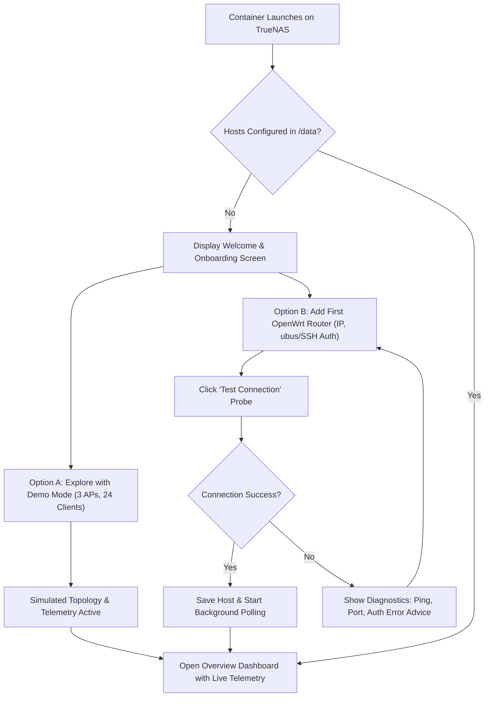
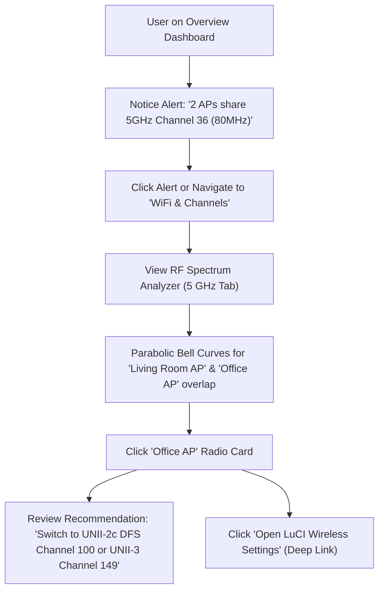
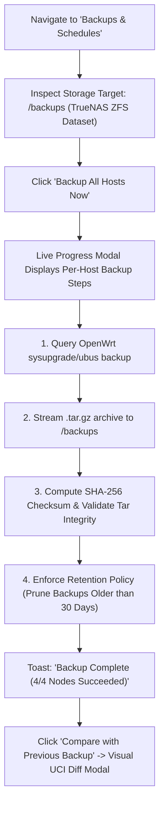

# OpenWrt Manager ("openwrt-managor") — UX Specification

**Version:** 1.0.0  
**Author:** UX Specialist (`@ux-specialist`)  
**Target Environment:** Docker container on TrueNAS SCALE (Web UI accessible via browser on desktop, tablet, and mobile)  
**Target Standard:** WCAG 2.2 Level AA Compliance  
**Audience:** `@architect`, `@developer`, `@ui-specialist`, `@test-engineer`, `@coordinator`

---

## 1. Executive Summary & Design Vision

### 1.1 Purpose & Vision
OpenWrt Manager (`openwrt-managor`) is a centralized, self-hosted web management console designed to run as a Docker container on TrueNAS SCALE. It aggregates monitoring, configuration backups, network layout visualization, client tracking, and RF spectrum analysis for deployments running one or more OpenWrt routers and access points.

Home lab enthusiasts, prosumers, and small business administrators frequently manage multi-AP OpenWrt topologies (e.g., a main gateway running OpenWrt x86/ARM and multiple secondary ceiling or mesh APs running MediaTek or Qualcomm chips). Managing these nodes traditionally requires logging into separate LuCI web interfaces, manually running SSH commands for backups, or guessing at channel overlap and roaming issues.

`openwrt-managor` solves this by providing:
1. **Unified Multi-Node Observability:** Centralized status, CPU/RAM/temperature load, active connections, and firmware versions across all OpenWrt routers and APs.
2. **Interactive Network Topology Map:** Visual node-link hierarchy mapping WAN $\to$ Gateway $\to$ Switch/Backhaul $\to$ Secondary APs $\to$ Wired & Wireless Clients with real-time throughput metrics.
3. **Network Host & Client Directory:** Rich client inventory with live signal strength meters, frequency bands, roaming history, and DHCP lease tracking.
4. **Visual RF Spectrum & Channel Coverage Analyzer:** Clear, visual Bell-curve spectrum charts across 2.4 GHz, 5 GHz, and 6 GHz bands with automated co-channel and adjacent-channel interference warnings.
5. **Resilient TrueNAS-Backed Configuration Backups:** Automated cron-scheduled and on-demand `.tar.gz` configuration backups saved directly to TrueNAS storage volumes, with SHA-256 validation, retention management, and visual UCI config diffing.
6. **Zero-Friction Onboarding & Demo Mode:** Works out of the box with an instant simulated multi-node topology for testing, evaluation, and offline development.

---

## 2. Target Personas & Core User Journeys

### 2.1 User Personas

| Persona | Profile | Primary Motivations | Pain Points with Existing Solutions |
| :--- | :--- | :--- | :--- |
| **Alex (TrueNAS Homelabber & Network Admin)** | Self-hosts storage, media, and infrastructure on TrueNAS SCALE. Runs an OpenWrt x86 gateway and 3 OpenWrt APs. | Wants automated backups to TrueNAS ZFS pools; needs a single dashboard to verify node health and client roaming without logging into 4 LuCI tabs. | Backups are manual or custom bash scripts; no single pane of glass for multi-AP firmware/uptime; difficult to see if APs are interfering on the 5 GHz band. |
| **Sam (Smart Home & IoT Enthusiast)** | 60+ connected devices across 2.4 GHz and 5 GHz, segregated across IoT, Guest, and Main VLANs. | Wants to quickly identify which AP a weak IoT camera is connected to and optimize channels to prevent drops. | LuCI's status page is device-local; finding an IoT device with an unknown IP requires hunting through multiple ARP tables. |
| **Jordan (Troubleshooter / Casual User)** | Non-expert setting up a mesh network with OpenWrt; needs clear visual cues rather than raw terminal logs. | Needs instant clarity when a link is degraded, a node is down, or channel congestion causes lag. | Dense technical jargon, lack of visual feedback, fear of breaking configs without reliable rollback backups. |

---

### 2.2 Core User Journeys

#### Journey 1: First-Time Onboarding & Exploration


#### Journey 2: Identifying & Resolving WiFi Channel Overlap


#### Journey 3: Automated and On-Demand Configuration Backup


---

## 3. Information Architecture & Navigation Framework

### 3.1 Application Shell Hierarchy

```
+---------------------------------------------------------------------------------------------------------+
| [LOGO] OpenWrt Manager       [Live / Demo Badge]   [Storage: 14.2 GB Free]    [Backup All]  [+ Add Host] |
+-----------------+---------------------------------------------------------------------------------------+
|  NAVIGATION     |  VIEW CONTAINER                                                                       |
|                 |                                                                                       |
|  [D] Dashboard  |  +---------------------------------------------------------------------------------+  |
|  [T] Topology   |  | View Header & Filter Bar                                                        |  |
|  [H] Hosts      |  +---------------------------------------------------------------------------------+  |
|  [W] WiFi RF    |  | View Main Content (KPIs, Graph Canvas, Host Table, RF Curves, or Backups)       |  |
|  [B] Backups    |  |                                                                                 |  |
|  [S] Settings   |  +---------------------------------------------------------------------------------+  |
|                 |                                                                                       |
|  -------------- |                                                                                       |
|  Node Status:   |                                                                                       |
|  * Gateway (Up) |                                                                                       |
|  * AP-North(Up) |                                                                                       |
|  * AP-East (Up) |                                                                                       |
+-----------------+---------------------------------------------------------------------------------------+
| SYSTEM FOOTER: Connected: 3 Hosts | Active Clients: 28 | Last Poll: 13:42:05 | Version: v1.0.0          |
+---------------------------------------------------------------------------------------------------------+
```

### 3.2 Global Navigation Model

The application uses a persistent two-level navigation model:
1. **Primary Global Sidebar (Left):** Always accessible, collapsible to icon-only mode on viewports under 1280px.
   - **Overview Dashboard (`#/overview`):** High-level operational health, KPI metrics, alerts, aggregate traffic sparklines.
   - **Topology Map (`#/topology`):** Interactive canvas node-link diagram with tier hierarchy and link health.
   - **Hosts & Clients (`#/clients`):** Searchable, filterable client inventory with real-time signal and connection metrics.
   - **WiFi & Spectrum (`#/wifi`):** 2.4 / 5 / 6 GHz RF frequency Bell-curve visualizer, co-channel warning matrix, radio hardware cards.
   - **Backups & Schedules (`#/backups`):** TrueNAS archive storage management, automated schedules, on-demand execution, config diff.
   - **Node Management (`#/nodes`):** Router connection credentials, health status, firmware versions, restart/reconnect controls.
2. **Top Header Bar:**
   - **System Status Indicator:** Dot status (🟢 All Systems Normal, 🟡 Degraded Connection, 🔴 Host Unreachable) with tooltip.
   - **Deployment Mode Indicator:** Pill badge indicating `Live TrueNAS Mode` or `Demo Mode` with one-click switcher.
   - **Storage Mount Health:** Real-time indicator for `/backups` mount status and available ZFS capacity.
   - **Global Quick Actions:**
     - `Backup All Now` (Primary Accent Button)
     - `+ Add OpenWrt Node` (Secondary Button)
     - `Refresh Now` (Icon Button with spinner on active fetch)
3. **Contextual Slide-Out Drawer (Right Side, 480px width):**
   - Pops out when any node, client, AP radio, or backup archive is clicked.
   - Allows deep inspection without losing the user's canvas or table scroll position.
   - Closes via `Esc` key, close button, or backdrop click.

---

## 4. View Specifications & Layouts

---

### View 1: Overview Dashboard

#### 1. Purpose & Layout Structure
The primary landing view providing an immediate 5-second pulse check of the entire network deployment.

```
+-----------------------------------------------------------------------------------------------------+
| OVERVIEW DASHBOARD                                                [Time Range: Realtime / 1h / 24h] |
+-----------------------------------------------------------------------------------------------------+
| [ KPI CARD 1 ]          | [ KPI CARD 2 ]          | [ KPI CARD 3 ]          | [ KPI CARD 4 ]        |
| OpenWrt Nodes           | Active Clients          | WiFi Health Index       | Backup Status         |
| 3 / 3 Online            | 34 Connected            | 98% Optimal             | Up-to-Date            |
| 🟢 All ubus responsive  | 28 Wireless, 6 Wired    | 0 Channel Conflicts     | Next: Today at 03:00  |
+-----------------------------------------------------------------------------------------------------+
| NETWORK THROUGHPUT (WAN & LAN)                                                                      |
| [ Real-time dual-line SVG sparkline: Download (Blue, 142 Mbps) vs Upload (Green, 28 Mbps) ]         |
+--------------------------------------------------+--------------------------------------------------+
| OPENWRT NODES SUMMARY GRID                       | RECENT ACTIVITY & ALERTS                         |
| +----------------------------------------------+ | * 13:40:02 - AP-Office: Client 84:A9:C4 roamed   |
| | Gateway (x86_64) | 192.168.1.1   | CPU 4%    | |   from AP-LivingRoom (-78 dBm -> -54 dBm)        |
| | 🟢 4 interfaces  | Uptime: 42d   | RAM 18%   | | * 13:30:00 - Backup: gateway-20261113.tar.gz     |
| +----------------------------------------------+ |   verified (SHA-256 match, 142 KB)               |
| | AP-LivingRoom    | 192.168.1.2   | CPU 12%   | | * 12:15:22 - WiFi Alert: Co-channel overlap on   |
| | 🟢 2.4G + 5G     | Clients: 18   | RAM 44%   | |   Channel 36 resolved                            |
| +----------------------------------------------+ | * 03:00:01 - Scheduled automated backup ran:    |
| | AP-Office        | 192.168.1.3   | CPU 8%    | |   3/3 nodes archived to /backups                 |
| | 🟢 2.4G + 5G + 6G| Clients: 10   | RAM 38%   | |                                                  |
| +----------------------------------------------+ | [ View Full Audit Log -> ]                       |
+--------------------------------------------------+--------------------------------------------------+
```

#### 2. KPI Cards Specification
1. **OpenWrt Nodes Card:**
   - **Primary Metric:** `X / Y Online` (e.g. `3 / 3 Online`).
   - **Indicator:** Solid green dot (all online), amber triangle (one or more degraded/unreachable), red exclamation (all offline).
   - **Subtext:** Quick link to Node Management view with breakdown of router vs AP roles.
2. **Active Clients Card:**
   - **Primary Metric:** Total unique active hosts (e.g. `34 Active`).
   - **Subtext:** Split pills: `28 Wireless` (with WiFi icon) | `6 Wired` (with Ethernet icon).
   - **Interaction:** Clicking navigates directly to `#/clients`.
3. **WiFi Health Index:**
   - **Primary Metric:** Computed health percentage (e.g. `98% Optimal`).
   - **Logic:** Deducts points for co-channel interference on 5GHz/6GHz (-15%), APs with channel utilization > 70% (-10%), or wireless clients with SNR < 15 dB (-2% per client).
   - **Subtext:** Warning badge if conflicts exist (e.g., `1 Co-channel warning`), else `Clean spectrum`.
4. **Backup Status Card:**
   - **Primary Metric:** `Up-to-Date` (Green) or `Attention Needed` (Amber/Red).
   - **Subtext:** Last completed backup timestamp (e.g., `Today at 03:00`) and countdown to next scheduled cron run (`Next in 13h 20m`).
   - **Action:** Micro-button `Run Now` embedded inside the card.

#### 3. Real-Time Network Throughput Sparkline
- Dual-line SVG chart displaying WAN Inbound (Download) and Outbound (Upload) over the last 60 seconds (polled every 2–3 seconds).
- Visual encoding: High-contrast blue line with fill gradient for Download; emerald green line with fill gradient for Upload.
- Interactive tooltip showing instantaneous transfer rates in human-readable units (Kbps / Mbps / Gbps) and timestamp.

---

### View 2: Network Topology Map

#### 1. Purpose & Layout Structure
An interactive node-link visualization mapping the physical and logical structure of the local network. It allows network admins to understand backhaul topology, identify bandwidth bottlenecks, and trace client associations.

```
+-----------------------------------------------------------------------------------------------------+
| NETWORK TOPOLOGY MAP                                                                                |
| Controls: [Zoom In] [Zoom Out] [Fit Screen] | Filters: [x] Wired  [x] Wireless  [x] Offline Clients  |
+-----------------------------------------------------------------------------------------------------+
|                                                                                                     |
|                                       [ INTERNET / WAN ]                                            |
|                                                |                                                    |
|                                                | (Wired 10G SFP+ Link)                              |
|                                                v                                                    |
|                                      +--------------------+                                         |
|                                      | OPENWRT GATEWAY    |                                         |
|                                      | 192.168.1.1 (x86)  |                                         |
|                                      +--------------------+                                         |
|                                        /        |       \                                           |
|                        (2.5G Eth)     /         |        \ (Wireless Mesh 5GHz, -58 dBm)            |
|                                      v          |         v                                         |
|                     +------------------+        |       +------------------+                        |
|                     | AP-LIVINGROOM    |        |       | AP-GARAGE (MESH) |                        |
|                     | 192.168.1.2      |        |       | 192.168.1.4      |                        |
|                     +------------------+        |       +------------------+                        |
|                       /        |      \         |         /           \                             |
|                      /         |       \        v        v             v                            |
|                     v          v        v   +-------+  +--------+   +--------+                          |
|                  [iPhone]   [AppleTV] [Mac] | NAS   |  | EV-Chg |   | Camera |                          |
|                  (5GHz)     (Wired)   (6G)  |(TrueNAS)|(2.4GHz) |   (2.4GHz) |                          |
|                                             +-------+  +--------+   +--------+                          |
+-----------------------------------------------------------------------------------------------------+
| Node Inspector Drawer (Slide-out on click)                                                          |
| Selected: AP-LIVINGROOM                                                                             |
| Model: OpenWrt 23.05.3 / MediaTek Filogic 830 | IP: 192.168.1.2 | MAC: 00:14:D1:E2:40:10             |
| Uptime: 14d 6h | Radios: 2.4 GHz (Ch 6, 20MHz), 5 GHz (Ch 36, 80MHz)                                |
| Connected Clients: 14 | Uplink: Eth0 (2.5 Gbps Full Duplex)                                         |
| Actions: [Open LuCI WebUI] [Reboot Node] [Backup Config] [Copy SSH Command]                         |
+-----------------------------------------------------------------------------------------------------+
```

#### 2. Visual Architecture & Node-Link Rules
1. **Tiered Structural Layout:**
   - **Tier 0:** WAN / External Gateway.
   - **Tier 1:** Primary OpenWrt Gateway Router (DHCP server, default route).
   - **Tier 2:** Secondary OpenWrt Access Points / Mesh Nodes / Managed TrueNAS Core.
   - **Tier 3:** Endpoint Client Devices (collapsible/expandable groups per AP or VLAN to prevent visual clutter).
2. **Link Visual Encoding:**
   - **Wired Ethernet:** Solid high-contrast line.
     - 10 Gbps: Thick purple line (`#8b5cf6`, 4px width).
     - 2.5 Gbps: Thick cyan line (`#06b6d4`, 3.5px width).
     - 1 Gbps: Emerald green line (`#10b981`, 2.5px width).
     - 100 Mbps (Fast Eth): Amber warning dashed line (`#f59e0b`, 2px dashed) indicating possible cable/port negotiation issue.
   - **Wireless Backhaul (Mesh):** Dashed line (`#3b82f6`, 2.5px dashed with animated dash-array flow showing active traffic direction).
     - Link label displaying frequency band, channel, and RSSI (e.g. `5 GHz Mesh (-58 dBm, 866 Mbps)`).
   - **Degraded / High Packet Loss Link:** Pulsing red/amber line (`#ef4444`) with warning triangle icon.
3. **Interactive Canvas Controls:**
   - Smooth pan (drag canvas or middle-click).
   - Pinch-to-zoom / mouse wheel zoom with limits ($0.25\times$ to $3.0\times$).
   - `Reset / Fit to Screen` keyboard shortcut (`Space` or icon button).
   - `Collapse Clients` toggle: Condenses individual client icons into a compact badge on each AP node (e.g. `+18 clients`), dramatically speeding up navigation on large networks.
4. **Node Selection Drawer:**
   - Clicking any node opens the 480px slide-out drawer with:
     - Real-time CPU, RAM, and Temperature dials.
     - Uplink & Downlink real-time bandwidth meters.
     - Radio status cards (SSID, channel, Tx power, client distribution).
     - Direct Action Buttons: `Open LuCI` (opens in new tab to `http://<node-ip>`), `Backup Now`, `Ping Diagnostics`, and `Copy SSH command` (`ssh root@<node-ip>`).

---

### View 3: Network Hosts & Clients View

#### 1. Purpose & Layout Structure
A comprehensive inventory of every device detected across all OpenWrt routers and APs, combining ARP, DHCP lease tables, and wireless association lists.

```
+-----------------------------------------------------------------------------------------------------+
| NETWORK HOSTS & CLIENTS                                                                             |
| Search: [ Q Filter by IP, MAC, Hostname, Vendor...                              ] [Export CSV]      |
| Filter Chips: [Host: All v] [Band: 2.4G | 5G | 6G | Wired] [VLAN: Main | IoT | Guest] [Only Active]  |
+-----------------------------------------------------------------------------------------------------+
| Hostname / Vendor     | IP Address    | MAC Address       | AP & Conn Type | Signal (RSSI) | Speed  |
+-----------------------------------------------------------------------------------------------------+
| MacBook-Pro-M2        | 192.168.1.142 | A4:83:E7:12:34:56 | AP-Office      | ||||| -48 dBm | 1200M  |
| Apple, Inc.           | Main VLAN 1   | Lease: 18h rem    | WiFi 6 (5GHz)  | SNR: 46 dB    | Rx/Tx  |
+-----------------------------------------------------------------------------------------------------+
| LivingRoom-AppleTV    | 192.168.1.180 | 40:A3:CC:89:AB:CD | AP-LivingRoom  | [Wired Port 2]| 1 Gbps |
| Apple, Inc.           | Main VLAN 1   | Static Lease      | Eth (1000BaseT)| N/A (Wired)   | Full   |
+-----------------------------------------------------------------------------------------------------+
| Ring-Doorbell-Pro     | 192.168.20.45 | 68:54:5A:98:76:54 | AP-LivingRoom  | ||... -78 dBm | 54M    |
| Amazon Technologies   | IoT VLAN 20   | Lease: 6h rem     | WiFi 4 (2.4G)  | ⚠️ SNR: 14 dB | Poor   |
+-----------------------------------------------------------------------------------------------------+
| TrueNAS-SCALE-Storage | 192.168.1.5   | 00:25:90:F1:E2:D3 | Gateway        | [Wired SFP+]  | 10 Gbps|
| Supermicro            | Management    | Static Lease      | Eth (10GBaseT) | N/A (Wired)   | Full   |
+-----------------------------------------------------------------------------------------------------+
| Showing 4 of 34 clients                                                     [< Prev] [Page 1 of 1] [Next >]|
+-----------------------------------------------------------------------------------------------------+
```

#### 2. Filtering, Sorting & Search Capabilities
- **Instant Search:** Instant search filter matching hostname, friendly nickname, IP address, MAC address, OUI vendor name, or DHCP client-id without round-trip latency.
- **Multi-Facet Filter Toolbar:**
  - `OpenWrt Host:` Dropdown filter to isolate clients associated with a specific router or AP.
  - `Connection Medium:` Toggle group: `All` | `Wired` | `2.4 GHz` | `5 GHz` | `6 GHz`.
  - `VLAN / Network:` Dropdown filter: `Main LAN` | `IoT (VLAN 20)` | `Guest (VLAN 30)`.
  - `Health Filter:` One-click filter for `Weak Signal (< -75 dBm)` to quickly identify devices suffering from roaming dead spots.
- **Sorting:** Columns sortable by IP address (natural numerical order), Hostname, Signal Strength (dBm), Real-time Throughput, and Lease Expiration.

#### 3. Data Presentation & Indicators
1. **Signal Strength Gauge:**
   - 5-bar vertical signal meter with color coding:
     - 5 bars (Green, $\ge -55\text{ dBm}$): Excellent.
     - 4 bars (Green, $-56$ to $-67\text{ dBm}$): Good.
     - 3 bars (Amber, $-68$ to $-75\text{ dBm}$): Fair.
     - 1-2 bars (Red, $< -75\text{ dBm}$): Poor / Warning indicator.
   - Text display includes exact RSSI in dBm and SNR tooltip on hover.
2. **Client Detail Drawer (Slide-Out on Row Click):**
   - Device friendly name editor (persisted in `/data/client_aliases.json`).
   - AP Roaming Timeline: Historical log of AP roaming events (e.g. `Roamed from AP-LivingRoom to AP-Office at 13:14:02 (-79 dBm -> -52 dBm)`).
   - Real-time Tx/Rx packet and byte counters.
   - Copyable IP, MAC, and CIDR subnet strings with one-click copy confirmation.

---

### View 4: WiFi APs & Channel Coverage Analyzer

#### 1. Purpose & Layout Structure
A visual RF spectrum analyzer mapping channel allocations across all managed OpenWrt AP radios on 2.4 GHz, 5 GHz, and 6 GHz bands. It enables immediate identification of co-channel interference and inefficient channel widths.

```
+-----------------------------------------------------------------------------------------------------+
| WIFI APs & CHANNEL COVERAGE ANALYZER                                                                |
| Band Selector:  [ 2.4 GHz (802.11b/g/n/ax) ]  [[ 5 GHz (802.11a/n/ac/ax) ]]  [ 6 GHz (802.11ax/be) ]|
+-----------------------------------------------------------------------------------------------------+
| SPECTRUM COVERAGE CHART (5 GHz Band)                                                                |
| ⚠️ WARNING: Co-channel overlap detected on Channel 36 (80 MHz) between AP-LivingRoom & AP-Office    |
|                                                                                                     |
| Signal                                                                                              |
|  0 dBm |                                                                                            |
|        |           +-----------------------+                                                        |
|        |          /  AP-LivingRoom (80MHz)  \                                                       |
| -40dBm |         /   Ch 36 (5180 MHz)        \                                                      |
|        |        /     +---------------------+ \                        +-----------------+          |
| -60dBm |       /     /  AP-Office (80MHz)    \ \                      / AP-Garage (40M)   \         |
|        |      /     /   Ch 36 (5180 MHz)      \ \                    /  Ch 149 (5745 MHz)  \        |
| -90dBm |-----+-----+---------------------------+-----+------------------+-------------------+------ |
| Chan:  | 36   40   44    48    52   56   60   64 | 100 104 108 112 116 | 149  153  157  161  165 |
| UNII:  |       UNII-1 (Non-DFS)        UNII-2A (DFS) |     UNII-2C (DFS)    |      UNII-3 (Non-DFS)     |
+-----------------------------------------------------------------------------------------------------+
| AP RADIOS & HARDWARE OVERVIEW                                                                       |
| +-------------------------------------------+ +---------------------------------------------------+ |
| | AP-LIVINGROOM - Radio 1 (5 GHz)           | | AP-OFFICE - Radio 1 (5 GHz)                       | |
| | Mode: 802.11ax (WiFi 6) | Width: 80 MHz   | | Mode: 802.11ax (WiFi 6) | Width: 80 MHz           | |
| | Center Channel: 36 (5180 MHz)             | | Center Channel: 36 (5180 MHz) ⚠️ Conflict          | |
| | Tx Power: 23 dBm (200 mW) | Clients: 14   | | Tx Power: 20 dBm (100 mW) | Clients: 8            | |
| | Channel Utilization: [||||||||....] 42%   | | Channel Utilization: [||||||||||..] 58%           | |
| | Recommendation: Move to DFS Ch 100 (Clean)| | Recommendation: Change to Ch 149 (UNII-3)         | |
| +-------------------------------------------+ +---------------------------------------------------+ |
+-----------------------------------------------------------------------------------------------------+
```

#### 2. Visual RF Bell-Curve Spectrum Specification
1. **Mathematical Representation:**
   - Each active AP radio is rendered as an inverted parabolic Bell curve centered at the radio's center frequency $f_c$ with base width equal to the channel bandwidth (20 MHz, 40 MHz, 80 MHz, or 160 MHz).
   - Curve height represents configured transmit power (dBm) or normalized signal strength scale ($-90\text{ dBm}$ to $-30\text{ dBm}$).
2. **Frequency Band Tabs:**
   - **2.4 GHz:** Channels 1 through 14 (2412 MHz to 2484 MHz). Highlights standard non-overlapping channels (1, 6, 11). Displays warning if an AP is configured on intermediate channels (e.g. 2, 3, 4, 7, 8).
   - **5 GHz:** Channels 36 to 165 (5180 MHz to 5825 MHz). Clearly labeled regulatory sub-bands:
     - `UNII-1 (Channels 36-48)`: Indoor non-DFS.
     - `UNII-2A (Channels 52-64)`: DFS radar-detecting.
     - `UNII-2C / Extended (Channels 100-144)`: DFS radar-detecting.
     - `UNII-3 (Channels 149-165)`: Non-DFS high-power.
   - **6 GHz (WiFi 6E / WiFi 7):** Channels 1 to 233 (5945 MHz to 7125 MHz). Displays UNII-5 through UNII-8 sub-bands with 80MHz and 160MHz blocks.
3. **Co-Channel & Adjacent-Channel Interference Detection:**
   - **Co-Channel Interference (CCI):** Triggered when two or more AP radios in the same deployment share the exact same primary channel or overlapping spectrum slice.
     - **Visual Cue:** Overlapping curve area is filled with a semi-transparent amber hatch pattern; an amber warning banner appears above the spectrum chart listing conflicting AP names and recommending alternate clean channels.
   - **DFS Status Indication:** APs operating on DFS channels display a blue badge `DFS (Monitoring)` or amber badge `DFS Radar Detected (Channel Switched)`.
4. **Foreign AP RF Triangulation & Spatial Radar Map (`public/js/charts/triangulation-map.js`):**
   - **Wireless-Only OpenWrt AP Anchor Nodes:** Renders draggable blue anchor nodes exclusively for managed OpenWrt hosts that have wireless radios (excluding wired-only routers/gateways). Each anchor displays its hostname and, when calibrated, its GPS (`lat°, lng°`) and `Alt (m)` badge.
   - **Geodetic (Lat / Long) & Altitude Calibration:**
     - Clicking **`Calibrate AP Lat / Long / Alt`** in the triangulation card header opens a batch calibration `<dialog>` modal listing all wireless OpenWrt APs with inputs for **Latitude (°)**, **Longitude (°)**, and **Altitude (m)**.
     - Individual AP coordinates can also be configured in the **Add / Edit OpenWrt Host** modal on the Fleet page (including a **Use Browser GPS** auto-fill button) or calibrated by dragging blue AP anchor nodes directly on the floorplan canvas.
   - **Viewport Sizing & Interactive Zoom/Pan:**
     - Header and on-canvas toolbar controls allow toggling between **Standard Size**, **Large Map** (`620px–780px` tall viewport persisted in `localStorage`), and **Full Screen** mode (`Esc` to exit).
     - Floating toolbar provides **Zoom In (`+`)**, **Zoom Out (`-`)**, and **Reset Zoom (`100%`)** up to `350%`, with mouse-wheel zoom and drag-to-pan across dense AP clusters.
   - **Triangulation Rings, Signal Vectors & Inspector Bar:**
     - Selecting any foreign AP (by clicking its crosshair marker on the map or clicking **`Locate`** in the Neighboring Networks table) renders dashed per-AP RSSI distance rings, signal power vectors (`dBm` & horizontal/3D distance in meters), an uncertainty halo (`±errorRadiusMeters`), and a bottom inspector bar showing solved `(x, y)` meters, **Est. Altitude (`m`)**, **Est. GPS (`lat°, lng°`)**, compass bearing, and confidence score.

---

### View 5: Backups & Automated Schedules Center

#### 1. Purpose & Layout Structure
Manages regular, automated configuration backups for all OpenWrt routers and APs, storing compressed archives onto TrueNAS storage volumes.

```
+-----------------------------------------------------------------------------------------------------+
| BACKUPS & AUTOMATED SCHEDULES                                                                       |
| Storage Target: /backups (TrueNAS ZFS Mount) | Available: 412.8 GB | Archives: 24 | Policy: 30 Days |
| Actions:  [ ⚡ Backup All Nodes Now ]   [ ⚙️ Configure Schedule ]   [ 📥 Export All Backups ]        |
+-----------------------------------------------------------------------------------------------------+
| AUTOMATED BACKUP SCHEDULE SUMMARY                                                                   |
| Status: 🟢 ACTIVE | Schedule: Daily at 03:00 UTC (Cron: 0 3 * * *) | Target: All 3 Online Nodes     |
| Retention: Retain last 30 daily backups per host | Verification: SHA-256 Checksum on creation       |
+-----------------------------------------------------------------------------------------------------+
| BACKUP ARCHIVES HISTORY                                                                             |
| Filter: [All Hosts v] [Status: Success | Failed] [Search Archives...                           ]    |
+-----------------------------------------------------------------------------------------------------+
| Timestamp       | Host Name       | Archive Filename                   | Size   | SHA-256   | Actions   |
+-----------------------------------------------------------------------------------------------------+
| 2026-11-13 03:00| Gateway (x86)   | backup-gateway-20261113-030001.tgz | 148 KB | e3b0c442..| [Diff]    |
| (Scheduled)     | 192.168.1.1     | Valid OpenWrt sysupgrade archive   |        | [Copy]    | [Download]|
+-----------------------------------------------------------------------------------------------------+
| 2026-11-13 03:00| AP-LivingRoom   | backup-livingroom-20261113-030002  | 64 KB  | 8f4b12a0..| [Diff]    |
| (Scheduled)     | 192.168.1.2     | Valid OpenWrt sysupgrade archive   |        | [Copy]    | [Download]|
+-----------------------------------------------------------------------------------------------------+
| 2026-11-12 18:22| AP-Office       | backup-office-20261112-182215.tgz  | 62 KB  | 4c90d811..| [Diff]    |
| (Manual Trigger)| 192.168.1.3     | Pre-firmware upgrade snapshot      |        | [Copy]    | [Download]|
+-----------------------------------------------------------------------------------------------------+
| Showing 3 of 24 backup archives                                             [< Prev] [1] [2] [Next >]|
+-----------------------------------------------------------------------------------------------------+
```

#### 2. Backup Execution Workflow & Modals
1. **Manual "Backup All Nodes Now" Flow:**
   - User clicks `⚡ Backup All Nodes Now`.
   - A modal appears showing real-time step progress for each node:
     - `Gateway: [====>-----------------] Fetching sysupgrade archive via ubus...`
     - `AP-LivingRoom: [====================] Saved (64 KB, SHA-256: 8f4b12a0)`
     - `AP-Office: [====================] Saved (62 KB, SHA-256: 4c90d811)`
   - On completion, modal displays summary with direct download link and dismisses cleanly.
2. **Configuration Diff & Inspection Modal:**
   - Triggered by clicking `[Diff]` on any backup row.
   - User can compare the selected backup with the immediate previous backup or against the live running router configuration.
   - Side-by-side split view highlighting added (green), modified (yellow), and deleted (red) UCI configuration lines (`/etc/config/network`, `/etc/config/wireless`, `/etc/config/firewall`, `/etc/config/dhcp`).
   - Includes tabbed file tree inside the `.tar.gz` archive for browsing specific config files without extracting locally.
3. **Schedule Configuration Modal:**
   - Schedule presets: `Daily at 03:00`, `Weekly (Sundays at 04:00)`, or `Custom Cron Expression`.
   - Host inclusion checkboxes: Select all or choose specific nodes.
   - Retention policy slider: Number of backup archives to keep per host (e.g. 7, 14, 30, 90 days, or unlimited).

---

### View 6: Host Management Modal & Drawer

#### 1. Purpose & Layout Structure
Provides full lifecycle configuration for registering, testing, editing, and diagnosing OpenWrt hosts managed by the container.

```
+-----------------------------------------------------------------------------------------------------+
| MODAL / DRAWER: Add / Edit OpenWrt Node                                                         [X] |
+-----------------------------------------------------------------------------------------------------+
| Display Name:      [ AP-LivingRoom                                                        ]         |
| Host IP / FQDN:    [ 192.168.1.2                                                         ]         |
| Connection Protocol: (o) ubus HTTP (Port 80)   ( ) ubus HTTPS (Port 443)   ( ) SSH Direct           |
| Username:          [ root                                                                ]         |
| Password / Token:  [ •••••••••••••••••••••                                                ] [Show]  |
| Backup Method:     [ ubus call system sysupgrade_backup / SSH sysupgrade -b              v]         |
| SSH Port (Opt):    [ 22   ]     SSH Private Key: [ Use Container Key / Upload Key        v]         |
+-----------------------------------------------------------------------------------------------------+
| CONNECTION TEST PROBE                                                                               |
| [ Test Connection Now ]                                                                             |
| Result: 🟢 Connection Successful!                                                                   |
|   * Latency: 2.4 ms                                                                                 |
|   * Hostname: OpenWrt-LivingRoom                                                                    |
|   * Model: MediaTek MT7915E 802.11ax                                                                |
|   * OpenWrt Release: 23.05.3, r23809-234f1a2efa                                                     |
|   * Radios Detected: radio0 (2.4 GHz 802.11ax), radio1 (5 GHz 802.11ax)                            |
+-----------------------------------------------------------------------------------------------------+
| [ Cancel ]                                                             [ Save & Start Monitoring ]  |
+-----------------------------------------------------------------------------------------------------+
```

#### 2. Test Connection Diagnostics
- When the user inputs host parameters, clicking `Test Connection Now` executes an asynchronous probe via `/api/hosts/test`.
- If successful, it displays detected hardware specs, OpenWrt release version, and wireless radio interfaces to give the user immediate visual confidence before saving.
- If unsuccessful, the UI displays precise diagnostic advice:
  - `HTTP 401 Unauthorized:` "Check ubus credentials. Ensure user has read permissions for ubus namespace."
  - `Connection Refused (Port 80/443):` "Verify uhttpd is running on the router and firewall allows traffic from TrueNAS IP."
  - `Timeout (> 5000 ms):` "Host unreachable. Verify IP and routing between TrueNAS and router subnet."

#### 3. Demo Mode Switcher
- A persistent toggle in Settings and the Header Bar: `Demo Mode (Simulated Network)`.
- When active:
  - Loads a realistic 3-node OpenWrt deployment (1 Gateway, 2 APs) with 24 simulated active clients.
  - Dynamically simulates traffic spikes, client RSSI fluctuations, and scheduled backups so all visualizers can be demonstrated and tested without physical hardware.

---

## 5. Interaction States & Error Handling Design

### 5.1 Loading Skeletons
To avoid jarring layout shifts during data polling, all views utilize CSS-animated shimmer loading skeletons rather than blocking spinners:
1. **KPI Cards:** Pulsing rounded rectangle for the numerical metric ($48\text{px}\times 32\text{px}$) and subtext bar ($120\text{px}\times 16\text{px}$).
2. **Topology Canvas:** High-tech radar sweep grid overlay with placeholder node circles and dashed skeleton links while initial topology is calculated.
3. **Hosts Table:** 6 placeholder rows with shimmering text blocks for Hostname, IP, MAC, and Signal bars.
4. **Spectrum Analyzer:** Faint frequency baseline grid with a pulsing wave shimmer across the 2.4 GHz / 5 GHz frequency axis.

---

### 5.2 Empty States Specification

Every view provides a high-empathy empty state featuring:
1. A clear, non-technical explanatory headline.
2. A descriptive paragraph explaining why no items are shown.
3. A primary Call-To-Action (CTA) button to resolve the state.

| View | Empty Trigger | Visual Representation | Actionable CTA |
| :--- | :--- | :--- | :--- |
| **Overview** | Zero hosts configured | Clean router graphic with dashed connection lines | Primary button: `[+ Add First OpenWrt Node]` & Secondary button: `[Load Demo Environment]` |
| **Topology** | Hosts added but all offline | Map with dimmed gateway and warning icons | Button: `[Check Host Connections]` |
| **Clients Table** | Search / filter returns 0 items | Filter funnel graphic with zero-result badge | Button: `[Clear All Filters]` (restores full table) |
| **WiFi Analyzer** | Connected hosts have no WiFi radios (wired-only) | Radio tower with slash graphic: "No active wireless radios detected on managed hosts." | Informative callout with guide to configure wireless in OpenWrt |
| **Backups** | No archives created yet | TrueNAS ZFS storage pool icon: "Storage directory `/backups` is ready." | Primary button: `[Run First Backup Now]` & `[Configure Schedule]` |

---

### 5.3 Connection Error Banners & Reconnection UX
When communication with an OpenWrt node or the TrueNAS backend fails:
1. **Global Non-Intrusive Banner:**
   - Appears below the header with an amber/red gradient border:
     `⚠️ Lost connection to TrueNAS backend API. Polling paused. Reconnecting in 5s... [Retry Now]`
   - Counts down smoothly: 5s, 4s, 3s... then executes automatic retry.
2. **Per-Host Offline Pill:**
   - In tables and cards, unreachable hosts display a red status badge `🔴 Unreachable (Timeout)`.
   - Tooltip details: `Last seen 4 minutes ago. Last error: ETIMEDOUT 192.168.1.3:80`.
   - Cached telemetry remains visible with a subtle grayscale opacity ($0.75$) to prevent data flashing.

---

### 5.4 Toast Notification System
- Position: Bottom-right corner of the viewport (stacks upward, max 4 visible toasts).
- Auto-dismiss: Informational/Success toasts dismiss after 4 seconds; Warnings persist for 8 seconds; Error toasts persist until manually dismissed with `[X]`.
- Structure:
  - **Success:** Green left border, checkmark icon, bold title, concise description, optional action link (e.g., `Backup Completed: backup-gateway-20261113.tar.gz [Download]`).
  - **Warning:** Amber left border, warning triangle icon, action link (e.g., `Channel Overlap Detected: View Spectrum`).
  - **Error:** Red left border, exclamation icon, error message, `[Copy Error Log]` button.

---

### 5.5 Destructive Action Confirmation Dialogs
Actions such as deleting a backup archive, removing a managed host, or rebooting a router require explicit two-step confirmation using native HTML5 `<dialog>`:
- The dialog specifies the exact object name in bold (e.g. `Are you sure you want to delete backup-gateway-20261113-030001.tgz?`).
- The primary action button is styled with destructive red styling (`bg-red-600 hover:bg-red-700`).
- For router reboot or node removal, a safety checkbox or confirmation text entry is enforced to prevent accidental clicks.

---

## 6. Accessibility & Usability Engineering (WCAG 2.2 AA Compliance)

### 6.1 Semantic HTML5 Landmarks & Structure
The web frontend adheres strictly to semantic document structure:
- `<header role="banner">` for global branding, system status, and primary actions.
- `<nav role="navigation" aria-label="Main Navigation">` for the primary view switcher.
- `<main role="main" id="main-content">` containing the active view.
- `<aside role="complementary" aria-label="Node Inspector">` for the contextual slide-out drawer.
- `<dialog role="dialog" aria-modal="true">` for all modals.
- Skip Navigation Link: `<a href="#main-content" class="sr-only focus:not-sr-only">Skip to main content</a>` as the first focusable element.

---

### 6.2 Native `<dialog>` Modal Guidelines
All modal dialogs (Add Host, Backup Progress, Config Diff, Destructive Confirmation) must utilize native `<dialog>` elements:
1. Opened using `.showModal()` to automatically activate browser-level focus trapping and backdrop dimming.
2. The `Esc` key automatically triggers dialog dismissal and cancels any pending non-destructive action.
3. Upon opening, initial focus moves to the first interactive field (or the Cancel button for destructive modals).
4. Upon closing, focus is strictly restored to the trigger element that launched the modal.
5. All modals must have `aria-labelledby="dialog-title"` pointing to an `<h2>` heading.

---

### 6.3 Comprehensive Keyboard Navigation

| Key / Shortcut | Scope | Interaction Description |
| :--- | :--- | :--- |
| `Tab` / `Shift + Tab` | Global | Sequentially navigates through all interactive controls in logical reading order. |
| `/` | Global | Immediately focuses the global client search input on the Hosts view. |
| `1` through `5` | Global (when not typing) | Quick jump to views: `1` Overview, `2` Topology, `3` Hosts, `4` WiFi, `5` Backups. |
| `Esc` | Global | Closes open drawers, modals, dropdown menus, or deselects active canvas nodes. |
| `R` | Global (when not typing) | Triggers immediate manual telemetry refresh from all OpenWrt nodes. |
| `Space` or `Enter` | Canvas / Table | Activates selected node or row, opening the inspector drawer. |
| `Arrow Keys` | Topology Map | Pans the canvas view smoothly in the arrow direction. |
| `+` / `-` | Topology Map | Zooms in and out of the topology diagram. |

---

### 6.4 Screen Reader Announcements (`aria-live`)
- Background polling updates (throughput sparklines, RSSI changes) must **not** trigger vocal interruptions.
- `aria-live="polite"` is designated for:
  - Completion of backup operations (`"Backup for 3 nodes completed successfully"`).
  - Search filter results counter (`"Filtering complete. 8 clients found matching 'Apple'"`).
- `aria-live="assertive"` is reserved exclusively for critical alerts:
  - Node connection failure (`"Alert: OpenWrt Gateway unreachable at 192.168.1.1"`).
  - DFS radar detection event.

---

### 6.5 High-Contrast Color System & Colorblind Redundancy

#### Color Tokens & Contrast Ratios against Dark Theme Canvas (`#0f172a`)

| Color Token | Hex Code | Purpose / UI Element | Minimum Contrast Ratio | WCAG 2.2 AA Result |
| :--- | :--- | :--- | :--- | :--- |
| **Canvas Background** | `#0f172a` | Deep Slate Dark Background | Base | N/A |
| **Card / Surface** | `#1e293b` | Elevated cards, tables, modals | 1.3:1 vs Canvas | Surface contrast |
| **Text Primary** | `#f8fafc` | Headings, primary metrics, labels | **15.8:1** | Exceeds 4.5:1 (Pass) |
| **Text Muted** | `#94a3b8` | Subtitles, timestamps, MAC labels | **5.4:1** | Exceeds 4.5:1 (Pass) |
| **Brand Primary** | `#3b82f6` | Active tabs, primary buttons | **4.6:1** | Exceeds 4.5:1 (Pass) |
| **Status Green** | `#22c55e` | Node Online, Optimal WiFi, 1G Link | **6.1:1** (large text / icons) | Pass (3:1 graphical) |
| **Warning Amber** | `#f59e0b` | Channel Conflict, Weak RSSI, 100M Link | **5.8:1** (icons & badges) | Pass (3:1 graphical) |
| **Error Red** | `#ef4444` | Node Offline, Backup Failure | **4.8:1** (icons & badges) | Pass (3:1 graphical) |
| **Accent Cyan** | `#06b6d4` | 2.5G Links, 5GHz WiFi curves | **7.2:1** | Exceeds 4.5:1 (Pass) |
| **Accent Purple** | `#a855f7` | 10G Links, 6GHz WiFi curves | **5.1:1** | Exceeds 4.5:1 (Pass) |

#### Colorblind Accessibility Rules
Color is **never** used as the sole conveyor of information:
1. **Online/Offline Status:** Green dot includes a checkmark icon `✓` and text label `"Online"`; Red dot includes an exclamation mark `!` and text label `"Offline"`.
2. **Signal Strength:** In addition to bar color, the interface displays numeric dBm values (`-52 dBm`) and semantic text badges (`Excellent`, `Good`, `Fair`, `Poor`).
3. **Channel Conflict Warning:** The overlapping spectrum curves feature both an amber hue and a hatched diagonal SVG texture pattern (`patternUnits="userSpaceOnUse"`).

---

## 7. Responsive Viewport Breakpoints & Multi-Device UX

```
+------------------------------------------------------------------------------------------------------+
| BREAKPOINT MATRIX                                                                                    |
|                                                                                                      |
| 1. Desktop / TrueNAS Web UI (>= 1440px):                                                             |
|    * Full fixed sidebar (240px)                                                                      |
|    * 4-column KPI cards                                                                              |
|    * Side-by-side Topology Canvas and 480px Inspector Drawer                                         |
|    * Full 8-column Client Table                                                                      |
|    * Full multi-band spectrum analyzer with simultaneous 2.4G, 5G, and 6G views                     |
|                                                                                                      |
| 2. Laptop / Tablet Landscape (1024px - 1439px):                                                      |
|    * Collapsed sidebar (64px, icon-only with tooltips)                                               |
|    * 2x2 grid KPI cards                                                                              |
|    * Topology Inspector Drawer overlays canvas with backdrop blur                                    |
|    * Horizontal scroll for client table with sticky Hostname column                                  |
|                                                                                                      |
| 3. Tablet Portrait (768px - 1023px):                                                                 |
|    * Top app bar with slide-out off-canvas navigation menu                                           |
|    * 2-column KPI cards                                                                              |
|    * Spectrum charts switch to single-band tabs with horizontal swipe                                |
|    * Backups table hides SHA-256 column (accessible via row expansion)                               |
|                                                                                                      |
| 4. Mobile Devices (375px - 767px):                                                                   |
|    * Bottom navigation bar for primary tabs: [Overview] [Topology] [Clients] [WiFi] [Backups]        |
|    * Single-column stacked KPI cards                                                                 |
|    * Clients table converts to touch-friendly card list with expandable details                      |
|    * Topology canvas displays simplified hierarchy with pinch-zoom support                           |
+------------------------------------------------------------------------------------------------------+
```

---

## 8. Frontend Implementation Checklist for Developers & UI Specialists

This checklist serves as the acceptance criteria for `@developer` and `@ui-specialist` during implementation:

### Navigation & Shell
- [ ] Responsive navigation sidebar with active route highlighting and count badges.
- [ ] Top bar with dynamic Live/Demo mode badge and TrueNAS storage capacity gauge.
- [ ] Persistent quick-action buttons for `Backup All Now` and `+ Add Host`.
- [ ] System status pill showing real-time aggregate health with hover details.

### Overview Dashboard
- [ ] 4 KPI cards rendering live metrics (Nodes, Clients, WiFi Health, Backup Status).
- [ ] Real-time dual-line SVG sparkline charting WAN/LAN throughput.
- [ ] Node summary grid showing IP, CPU, RAM, and interface counts.
- [ ] Activity stream displaying recent roaming, backup, and connection events.

### Network Topology Map
- [ ] Interactive SVG/Canvas rendering multi-tier hierarchy (WAN $\to$ Gateway $\to$ APs $\to$ Clients).
- [ ] Visual distinction for link types: 10G (purple), 2.5G (cyan), 1G (green), 100M (amber dashed), Mesh (blue dashed).
- [ ] Zoom, pan, and fit-to-screen controls with smooth animations.
- [ ] Client node aggregation toggle (collapse/expand client leaves).
- [ ] 480px slide-out node inspector drawer with telemetry gauges and LuCI deep link.

### Hosts & Clients Directory
- [ ] High-density table with sticky headers and responsive layout.
- [ ] Instant search filtering across IP, MAC, hostname, and vendor.
- [ ] Facet filters for AP host, band (2.4G/5G/6G/Wired), VLAN, and signal quality.
- [ ] 5-bar visual signal meter with numeric dBm and SNR tooltip.
- [ ] Client detail drawer with roaming history log and friendly alias editor.

### WiFi Spectrum Analyzer
- [ ] Frequency tabs for 2.4 GHz, 5 GHz (UNII-1/2A/2C/3), and 6 GHz (UNII-5..8).
- [ ] Inverted parabolic Bell curves rendering 20/40/80/160 MHz channel allocations.
- [ ] Automated co-channel and adjacent-channel interference detection with warning banners.
- [ ] AP radio cards showing Tx power, channel utilization bar, and client count.

### Backups & Schedules Center
- [ ] TrueNAS `/backups` storage path indicator and capacity meter.
- [ ] Automated backup schedule configuration modal (cron picker, retention policy).
- [ ] On-demand `Backup All` trigger with real-time multi-host progress modal.
- [ ] Archive history table with SHA-256 checksum copy button and `.tar.gz` download link.
- [ ] UCI configuration diff modal (side-by-side split view of network, wireless, firewall).

### Host Management Modal
- [ ] Add/Edit host form (IP, ubus protocol, credentials, SSH key).
- [ ] `Test Connection Now` probe returning live latency, model, release, and radios.
- [ ] Demo mode toggle with realistic simulated multi-node network.

### Accessibility & Interaction States
- [ ] Native `<dialog>` used for all modals with focus trapping and `Esc` key handling.
- [ ] WCAG 2.2 AA color contrast verified ($\ge 4.5:1$ text, $\ge 3:1$ graphics).
- [ ] Colorblind-friendly indicators (icons + text labels + shapes).
- [ ] Shimmer loading skeletons for all cards, tables, and charts.
- [ ] Graceful empty states with actionable CTA buttons for all views.
- [ ] Keyboard navigation shortcuts (`/`, `1-5`, `Esc`, `R`).
- [ ] Screen reader announcements via `aria-live="polite"` and `aria-live="assertive"`.
