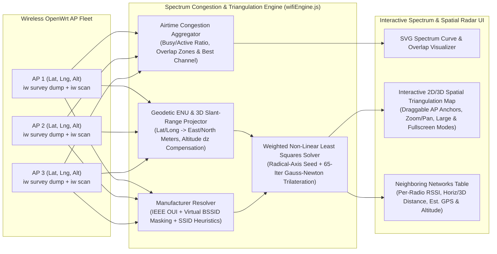

# Wi-Fi RF Spectrum Analysis & 3D Location Triangulation

[&larr; Back to Main README](../README.md)

OpenWrt Manager includes a multi-radio **Tri-Band RF Spectrum Congestion Analyzer** (`2.4 GHz`, `5 GHz`, and `6 GHz`) paired with a **3D Foreign AP Location Triangulation Engine** that uses your wireless OpenWrt access points as geodetic RF sensors.

---

## 1. Architecture Overview

---

## 2. Multi-Radio Spectrum Congestion & Airtime Analysis

### `iw survey dump` Telemetry
During each polling cycle and on-demand scan, OpenWrt Manager queries `iw dev <iface> survey dump` across all managed wireless interfaces to collect:
- **Channel Active vs. Busy Time (`utilizationPct`):** Computes the percentage of time each channel is busy with RF energy (`channel time busy / channel time`).
- **Ambient Noise Floor (`noiseFloorDbm`):** Captures the real-time noise floor in $\text{dBm}$ ($-101\text{ dBm}$ to $-90\text{ dBm}$).

### Spectral Envelope & Interference Detection
- **Parabolic Channel Lobes:** Renders $20\text{ MHz}$, $40\text{ MHz}$, $80\text{ MHz}$, and $160\text{ MHz}$ spectral curves across **2.4 GHz** (Channels 1–13), **5 GHz** (UNII-1, UNII-2/DFS, UNII-3, Channels 36–165), and **6 GHz** (UNII-5 through UNII-8, Channels 1–233).
- **Overlapping Congestion Zones:** Detects frequency range overlaps ($\text{centerFreq} \pm \frac{\text{width}}{2}$) between managed AP radios and strong neighboring networks ($\ge -70\text{ dBm}$), highlighting contested frequency bands directly on the SVG spectrum canvas.
- **Automated Channel Recommendations:** Evaluates candidate channels per band (`1, 6, 11` on 2.4 GHz; `36, 44, 52, 60, 100, 108, 116, 149, 157` on 5 GHz; `1, 33, 65, 97, 129, 161, 193` on 6 GHz) using a composite congestion penalty:
  $$\text{Score}(c) = \min\!\Big(100,\; \text{round}\big(N_{\text{co}} \cdot 22 + N_{\text{adj}} \cdot 14 + U_{\text{busy\%}} \cdot 0.65 + P_{\text{foreign}}\big)\Big)$$
  The lowest-scoring channel is surfaced as the **Recommended Cleanest Channel**.

---

## 3. Active Neighbor Scanning & Hardware Manufacturer Identification

Clicking **Scan Wireless Environment** (`POST /api/wifi/scan`) executes concurrent `iw dev <iface> scan` passes across all wireless OpenWrt hosts:
- **Multi-Radio RSSI Comparison:** Aggregates every discovered neighboring network by `(BSSID, band)` and records the signal strength ($\text{dBm}$) observed by each OpenWrt AP, sorted strongest-first (` Office AP: -52 dBm `, ` Living Room AP: -68 dBm `).
- **3-Tier Manufacturer Identification (`resolveWifiManufacturer`):**
  1. **Direct IEEE OUI Lookup:** Matches the upper 24-bit prefix (`XX:XX:XX`) against the built-in OUI database.
  2. **Locally-Administered Virtual BSSID Bit-Masking:** Consumer and enterprise multi-SSID routers frequently flip the locally-administered bit (`0x02`) or increment upper nibble bits (`b0 & ~0x0e`) on secondary virtual APs. The resolver unmasks these bits to recover the underlying hardware vendor (e.g., Ubiquiti, MikroTik, ASUS, Fritz!Box, TP-Link, Netgear).
  3. **SSID Keyword & ISP Prefix Heuristics:** Matches known router and ISP signatures (`Vodafone`, `BT-`, `Sky`, `VirginMedia`, `FRITZ!Box`, `Archer`, `Orbi`, `UniFi`, `Deco`, `Eero`, etc.).

---

## 4. 3D Foreign AP RF Triangulation & Geodetic Calibration

### Wireless-Only AP Anchor Filtering
Only OpenWrt hosts that have active wireless radios (`hasWirelessRadios: true`) are included as triangulation anchors (`filterWirelessHosts`). Wired-only OpenWrt gateways, routers, or switches without Wi-Fi interfaces are automatically excluded so they do not skew spatial scaling or appear as uncalibrated anchor points on the radar map.

### Geodetic (`Latitude`, `Longitude`, `Altitude`) Calibration
Each wireless OpenWrt AP can be configured with physical coordinates via either:
- **Calibrate AP Lat / Long / Alt** button in the RF Triangulation card header (batch calibration modal for all wireless APs), or
- **Edit Host** modal on the **OpenWrt Hosts** page.

Supported calibration fields per wireless AP:
| Field | Unit | Range | Purpose |
| :--- | :--- | :--- | :--- |
| **Latitude** | Decimal Degrees (`°`) | `-90` to `90` | North/South GPS anchor coordinate |
| **Longitude** | Decimal Degrees (`°`) | `-180` to `180` | East/West GPS anchor coordinate |
| **Altitude** | Meters (`m`) | `-500` to `10000` | Floor height / elevation above sea level or ground floor |

### Mathematical Pipeline
1. **East-North-Up (ENU) Geodetic Projection:**
   When $\ge 2$ wireless APs have `latitude` and `longitude`, OpenWrt Manager projects their geographic coordinates onto a local tangent plane in meters centered on the AP fleet's mean $(\bar{\phi}, \bar{\lambda})$:
   $$\Delta x_{\text{east}} = (\lambda_i - \bar{\lambda}) \cdot 111320 \cos(\bar{\phi}), \qquad \Delta y_{\text{north}} = (\phi_i - \bar{\phi}) \cdot 111132$$
2. **Log-Distance Path-Loss 3D Slant Range:**
   Each observing AP's RSSI is converted into an estimated 3D slant distance $d_{3\text{D},i}$ using a band-calibrated log-distance path-loss model ($P_{\text{tx}} = 18\text{ dBm}$, path-loss exponent $n \in [2.65, 2.85]$, free-space reference loss $L_0(f_{\text{MHz}})$).
3. **3D Vertical Elevation & Horizontal Ground-Plane Projection:**
   When AP `altitude` values are configured across multiple stories or mounting heights:
   - The foreign AP's estimated altitude $\hat{z}$ is computed via signal-weighted averaging of the observing AP altitudes.
   - Each 3D slant range $d_{3\text{D},i}$ is projected onto the 2D horizontal plane using the vertical elevation delta $\Delta z_i = z_i - \hat{z}$:
     $$d_{\text{horiz},i} = \sqrt{\max\!\left(0.5^2,\; d_{3\text{D},i}^2 - \Delta z_i^2\right)}$$
4. **Weighted Non-Linear Least Squares (Gauss-Newton) Trilateration:**
   - **1 Observing AP:** Places the foreign AP along a deterministic BSSID azimuth at radius $d_{\text{horiz},1}$ (`confidence: "low"`, `"Single-AP Distance Ring"`).
   - **2 Observing APs:** Solves the radical-axis circle-circle intersection and refines via damped weighted Gauss-Newton iterations (`confidence: "medium"`, `"Dual-AP Bi-Lateration"`).
   - **3+ Observing APs:** Solves full multi-AP trilateration over 65 damped Gauss-Newton iterations minimizing $\sum_i w_i (\|\mathbf{p} - \mathbf{a}_i\| - d_{\text{horiz},i})^2$ (`confidence: "high"`, `"Multi-AP Trilateration"`), and back-projects $(x, y)$ into estimated **Foreign AP GPS Latitude, Longitude, and Altitude**.

---

## 5. Interactive Spatial Radar Map Controls

- **Draggable AP Anchors:** Drag any green OpenWrt AP node directly on the SVG canvas to fine-tune its floorplan position (`PUT /api/hosts/:id`).
- **Foreign AP Inspector & Distance Rings:** Click any cyan/amber foreign AP marker (or click **Locate on Map** in the Neighboring Networks table) to display dashed per-AP horizontal distance rings, radial vectors (`5.4m` or `5.4m (3D 6.1m)`), estimated GPS coordinates, and confidence badges.
- **Viewport Sizing & Zoom/Pan:**
  - **Large Map / Compact Map:** Expands the radar viewport from `420px` to `720px` height.
  - **Full Screen (`Esc` to exit):** Expands the entire triangulation workspace into a full-viewport overlay.
  - **Zoom & Pan Toolbar:** Floating `+`, `-`, and `100%` reset controls (up to `400%` zoom), mouse-wheel zoom centered on the cursor, and click-and-drag background panning.
